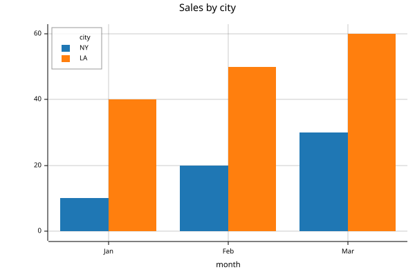
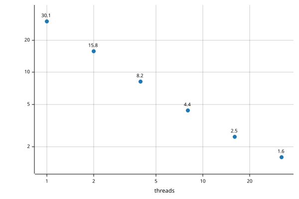

# Python


<!-- WARNING: THIS FILE WAS AUTOGENERATED! DO NOT EDIT! -->

``` python
from basedpl import bpl, fn, Array, add, tally
import numpy as np
```

## Rustymath vs BasedPL

Both packages use Rustymath’s numerical core and share leading-axis
broadcasting, Python selectors, and the `.keys` and `.names` metadata
interface. Choose Rustymath for eager numerical arrays, or BasedPL for
BPL values and composable functions.

<table>
<colgroup>
<col style="width: 33%" />
<col style="width: 33%" />
<col style="width: 33%" />
</colgroup>
<thead>
<tr>
<th></th>
<th>Rustymath</th>
<th>BasedPL</th>
</tr>
</thead>
<tbody>
<tr>
<td>Values</td>
<td>Homogeneous arrays of fixed dtype</td>
<td>Exact, mixed and nested values, functions and operators</td>
</tr>
<tr>
<td>Integer arithmetic</td>
<td>Fixed-width results can wrap</td>
<td>Ordinary exact integers can grow; explicit fixed-width integers
wrap</td>
</tr>
<tr>
<td>Execution</td>
<td>Eager numerical operations</td>
<td>Function fusion, batching and automatic differentiation</td>
</tr>
<tr>
<td>Results</td>
<td>Python scalars when all inputs are scalars</td>
<td>Native BPL values; convert explicitly with <code>.py</code> or
<code>.np</code></td>
</tr>
<tr>
<td>Function notation</td>
<td>Ordinary Python calls</td>
<td>Also currying, composition and BPL argument/axis conventions</td>
</tr>
<tr>
<td>Settings</td>
<td>Explicit Mathish functions and a process-wide thread setting</td>
<td>Process-wide preferences shared with BPL evaluation</td>
</tr>
</tbody>
</table>

Python operators prefer BasedPL when a Rustymath array and a BasedPL
value occur together. Converting ordinary arrays preserves supported
dtypes and labels. Active BPL differentiation or batching values cannot
convert to Rustymath.

Rustymath’s ordinary functions use exact comparisons. The
`rustymath.mathish` namespace provides J-inspired numerical conventions.
BasedPL enables them for [Mathish types](terms.qmd#term-mathish-types)
under default dynamic kinds. `bpl.prefs({'mathish': False})` disables
them without changing the kinds setting.
[Numbers](numbers.qmd#mathish-mode) describes the comparison and
zero-division rules.

## Native arrays

`bpl` is the BPL workspace. It keeps its names for the life of the
Python process. Calling it returns a native `basedpl.Array`. It retains
nesting, exact numbers and empty-array prototypes. Use `.np` or `.py` to
convert it.

``` python
v = bpl('1 2 4')
v
```

    1 2 4

Python operators use BPL’s array semantics. Precedence follows Python,
which multiplies before adding:

``` python
v * 2 + 1
```

    3 5 9

Indexing counts from 0, as in Python. Negative positions count from the
end. Slices take a start, stop and step, as Python’s do. Iteration
yields rows of a matrix rather than individual items:

``` python
a = bpl('2 3⍴⍳6')
a.shape, a[0, :], a[:, 1:], a[:, -1], list(a)
```

    ((2, 3),
     [0., 1., 2.],
     [[1., 2.], [4., 5.]],
     [2., 5.],
     [[0., 1., 2.], [3., 4., 5.]])

BPL also exposes functions by their word names. `add.reduce` is `+/`,
and `add.reduce.each` is `+/¨`. Applied to this nested vector, `+/¨`
sums each item:

``` python
nested = bpl('[[1 2] [3 4 5]]')
nested
```

    (1 2⋄3 4 5)

In Python, chain the corresponding word functions:

``` python
add.reduce.each(nested)
```

    3 12

``` python
f = add.reduce.each
f(nested)
```

    3 12

`Array(1, 2, 4)` makes a vector, as does `Array([1, 2, 4])`. A single
argument keeps its own meaning: `Array(3)` is an atom. Python integers
become ordinary exact values. Their NumPy export uses `int64` under
dynamic kinds.

Functions compose too: `add.reduce / tally` builds the mean function
`+/÷≢`. Its result is still a native array, even when it holds a single
number:

``` python
exact = Array(1, 2, 4)
assert exact.np.dtype == np.int64
mean_native = add.reduce / tally
mean_native(exact)
```

    7ᵣ3

The native representation uses Python numeric notation: `2` is exact and
`2.` is approximate. `.bpl` returns the BPL display as a string:

``` python
v.bpl, exact.bpl
```

    ('1 2 4', '[1 2 4]ₓ')

## The workspace

`bpl` is shared by the whole Python process, including the [notebook
magics](notebooks.ipynb). `bpl(']clear')` removes every name and
restores the starting display settings.

Calling `bpl` returns a native array or function and prints explicit BPL
output. It suppresses implicit BPL display. Use `.np` or `.py` when you
need a converted result:

``` python
bpl('3 3⍴⍳9').np
```

    array([[0., 1., 2.],
           [3., 4., 5.],
           [6., 7., 8.]])

Module and `bpl` attributes give the builtins by name. For example,
`bpl.conjugate(2+3j)` conjugates, `bpl.add(2)` adds 2, and
`bpl.multiply(2)` doubles. [Word functions](#word-functions) explains
the names:

``` python
bpl.conjugate(2+3j).py, bpl.add(2)(3).py, bpl.multiply(2)([1, 2, 3]).py
```

    ((2-3j), 5, array([2, 4, 6]))

Keyword arguments bind Python values in the workspace. Square brackets
read a BPL expression or assign a value:

``` python
bpl(x=np.arange(1, 6))
bpl['v'] = [3,1,4,1,5]
bpl['<v'].np
```

    array([1, 1, 3, 4, 5])

`fn` makes a composable `Function` from a BPL function expression. It is
the same as `bpl.fn`. Pass one argument for a monadic call or two for a
dyadic call. Python integers stay exact. `.py` converts this mean to a
`Fraction`:

``` python
bpl('mean←{⍝ Mean of a vector\n+/⍵ ÷ ≢⍵}')
mean = fn('mean')
mean([1,2,4]).py
```

    Fraction(7, 3)

### Names and help

Type `mean?` for its comment help and `mean??` for BPL source. The same
information is available programmatically:

``` python
mean.source, bpl.names('me')
```

    ('{⍝ Mean of a vector\n+/⍵ ÷ ≢⍵}', ['mean'])

See [names and help](introspection.ipynb) for source lookup, erasure and
inspection APIs.

`fn` is late-bound: `fn("foo")` follows later redefinitions of `foo`.
Use `bpl("foo")` to retain its current function.

Calls print only explicit output (`⎕←` and display commands). Each
output prints as soon as BPL produces it, before any later `⎕` prompt. A
second argument of `'explicit'` captures it instead, returning a
`Result` with the native `.value` and the captured `.output`:

``` python
r = bpl('⎕←x ⋄ ≥x', 'explicit', x=3)
assert r.value.py == 4
assert r.output == ['3ₓ']
```

`'repl'` also captures implicit expression display, as the BPL prompt
shows it. The `%%bpl` cell magic uses it. In ordinary Python notebooks,
append `;` to suppress display of a call’s return value.

## Labelled arrays

``` python
data = [[10, 20, 30], [40, 50, 60]]
keys = ('NY', 'LA'), ('Jan', 'Feb', 'Mar')
sales = Array(data, keys=keys, names=('city', 'month'))
sales.names, sales.keys
```

    (('city', 'month'), (('NY', 'LA'), ('Jan', 'Feb', 'Mar')))

Keys select as positions do. A slice of keys includes its end key, as
pandas’ `.loc` does:

``` python
sales[:, 'Jan':'Feb']
```

     ₓ Jan Feb
    NY  10  20
    LA  40  50

Arithmetic matches named axes and aligns their keys, rather than relying
on order. This adjustment lists the months backwards but still adds 1 to
January, 2 to February and 3 to March in each city. `.df` copies the
result to pandas, preserving labels; install pandas to use it.

``` python
months = 'Mar', 'Feb', 'Jan'
adjustment = Array(3, 2, 1, keys=(months,), names=('month',))
(sales + adjustment).df
```

<div>
<style scoped>
    .dataframe tbody tr th:only-of-type {
        vertical-align: middle;
    }
&#10;    .dataframe tbody tr th {
        vertical-align: top;
    }
&#10;    .dataframe thead th {
        text-align: right;
    }
</style>

<table class="dataframe" data-quarto-postprocess="true" data-border="1">
<thead>
<tr style="text-align: right;">
<th data-quarto-table-cell-role="th">month</th>
<th data-quarto-table-cell-role="th">Jan</th>
<th data-quarto-table-cell-role="th">Feb</th>
<th data-quarto-table-cell-role="th">Mar</th>
</tr>
<tr>
<th data-quarto-table-cell-role="th">city</th>
<th data-quarto-table-cell-role="th"></th>
<th data-quarto-table-cell-role="th"></th>
<th data-quarto-table-cell-role="th"></th>
</tr>
</thead>
<tbody>
<tr>
<td data-quarto-table-cell-role="th">NY</td>
<td>11</td>
<td>22</td>
<td>33</td>
</tr>
<tr>
<td data-quarto-table-cell-role="th">LA</td>
<td>41</td>
<td>52</td>
<td>63</td>
</tr>
</tbody>
</table>

</div>

Assign `.keys` or `.names` to replace labels without reordering values.
Each tuple has one entry per axis; `None` marks an unlabelled axis or
clears all labels when assigned to the property. Relabelling an
`Array(sales)` copy leaves `sales` unchanged:

``` python
renamed = Array(sales)
renamed.names = ('place', 'month')
renamed.keys = (('New York', 'Los Angeles'), None)
assert sales.names == ('city', 'month') and sales.keys == keys
renamed.names, renamed.keys, sales.names
```

    (('place', 'month'), (('New York', 'Los Angeles'), None), ('city', 'month'))

## Plots

`plot` draws a chart from an array. Keys label the x axis and the
legend, and axis names become the axis titles. Keyword arguments set the
chart’s options, with a dictionary for each nested option:

``` python
legend = {'position': 'top-left'}
bpl.plot(sales, mark='bar', title='Sales by city', legend=legend)
```



A dict of equal-length lists is a table. Its `x` column supplies the x
values, and every other column is a series. [Plots](plot.ipynb) lists
all the settings.

``` python
threads = [1, 2, 4, 8, 16, 32]
seconds = [30.1, 15.8, 8.2, 4.4, 2.5, 1.6]
bpl.plot({'x': threads, 'seconds': seconds}, mark='point', labels=1,
    x={'title': 'threads', 'scale': 'log'}, y={'scale': 'log'})
```



## Values and conversion

`Array` retains atoms, shape, nesting, numeric domain and empty
prototypes. An atom and a scalar both have `.shape == ()`. `.is_atom` is
`True` only for an atom. `.bpl` gives the BPL display. `.py` converts
atoms to Python values and character vectors to strings. Other arrays
become NumPy arrays, including scalars. `.np` always returns an ndarray.

For [axis-keyed arrays](keyed.ipynb), `.py` returns a dict at rank 1 and
a pandas DataFrame at higher ranks. `.np` copies the values. Attach
labels with `Array(data, keys=[rows, cols])`; use `None` for an unkeyed
axis. `.keys` returns a tuple of label tuples or `None`.

`names` names dimensions; `keys` names positions within them. Matching
axis names align before positional broadcasting. `.names` returns one
name or `None` per dimension.

``` python
from basedpl import Array, add
```

``` python
m = Array([[1, 2, 3], [4, 5, 6]], names=('city', 'month'))
v = Array([10, 20, 30], names=('month',))
assert (m + v).np.tolist() == [[11, 22, 33], [14, 25, 36]]
assert add.reduce['month'](m).np.tolist() == [6, 15]
assert add.reduce['month'](m).names == ('city',)
```

`.df` converts any array to a DataFrame. The last axis gives the
columns. The earlier axes give the rows, as a MultiIndex above rank 2.
Unkeyed axes are labelled from 0. A vector of columns of one length, as
`•csv` or a DataFrame’s `Array` gives, converts by columns instead: each
column keeps its own dtype, and its keys give the index. Install pandas
for this conversion. Pandas is imported on demand.

Axis names become pandas index/column names, including MultiIndex level
names.

``` python
from fractions import Fraction
from basedpl import Array
```

``` python
assert Array(2).bpl == '2ₓ'
assert Array(2.).bpl == '2'
assert Array(Fraction(1, 3)).py == Fraction(1, 3)
assert Array([1, None]).bpl == '1 $n'
assert Array("x").shape == (1,) and Array({"n": "x"})["n"].shape == ()
assert Array([3, 2.5]).bpl == '3 2.5' and Array(value=3, score=2.5).bpl == '["value":3ₓ "score":2.5]'
```

<table>
<colgroup>
<col style="width: 50%" />
<col style="width: 50%" />
</colgroup>
<thead>
<tr>
<th>Python input</th>
<th>BPL value</th>
</tr>
</thead>
<tbody>
<tr>
<td><code>bool</code>, NumPy Booleans</td>
<td>Boolean</td>
</tr>
<tr>
<td><code>int</code></td>
<td><a href="numbers.qmd#weak-and-strong-numbers">Weak ordinary
integer</a>, exact under dynamic kinds</td>
</tr>
<tr>
<td>NumPy integers and typed integer buffers</td>
<td>Fixed-width integer, retaining supported dtype</td>
</tr>
<tr>
<td><code>float</code></td>
<td>Weak approximate real, at the default width</td>
</tr>
<tr>
<td><code>Fraction</code></td>
<td>Exact rational</td>
</tr>
<tr>
<td><code>complex</code></td>
<td>Weak approximate complex</td>
</tr>
<tr>
<td><code>None</code> as an item of a list, dict or frame</td>
<td>NaN, <code>$n</code>. A bare <code>None</code> doesn’t convert</td>
</tr>
<tr>
<td><code>str</code></td>
<td>Character vector. Inside a list, tuple or dict, a one-character
string is a character atom: <code>["a", "b"]</code> gives
<code>"ab"</code></td>
</tr>
<tr>
<td>Rectangular list/tuple/<code>range</code></td>
<td>Ordinary array</td>
</tr>
<tr>
<td>Ragged list/tuple</td>
<td>Nested array</td>
</tr>
<tr>
<td>NumPy ndarray or <code>__array__</code> provider</td>
<td>Array preserving shape and numeric domain</td>
</tr>
<tr>
<td><code>dict</code> with string keys</td>
<td><a href="keyed.ipynb">Keyed vector</a>, recursively.
<code>.py</code> returns a <code>dict</code></td>
</tr>
<tr>
<td>pandas DataFrame</td>
<td>Keyed vector of its columns, as <code>•csv</code> gives. The index
keys each column where every label is a string</td>
</tr>
</tbody>
</table>

NumPy float and complex scalars keep their explicit widths and are
strong, including inside sequences beside weak Python floats or complex
numbers. Exact numbers still join losslessly. A list’s items combine
under BPL’s usual joining rules: `[1, 2.5]` gives two floats. A dict’s
values each keep their own kind, as a record’s fields do. In
`{"name": "x", "age": 3, "score": 2.5}`, `age` stays exact beside the
float `score`. Its `name` is the character atom `'x'`.

`.np` or `np.asarray(a)` always produces an ndarray. Booleans use
`bool`. Fixed integers keep their selected dtype: `uint8`, `int16`,
`int32` or `int64`. Ordinary integers that fit signed 64 bits use
`int64` under dynamic kinds, and at least the `int` preference’s
computation width under static kinds. Floats use `float16`, `float32` or
`float64`; complex arrays use `complex64` or `complex128`. Fractions,
large integers, nested arrays and mixed exact and approximate values use
`object`. Character arrays use `U1`. The arrays inside a `.py` result,
and the columns of a `.df` result, use the same dtypes.

``` python
import numpy as np
```

`range` works on its own or inside a rectangular sequence. Objects with
`__array__`, such as a pandas Series, also convert. The numeric values
transfer without pandas labels:

``` python
a = Array([range(1, 4), range(4, 7)])
np.testing.assert_array_equal(a.np, [[1, 2, 3], [4, 5, 6]])
```

``` python
np.testing.assert_array_equal(Array(sales.df.loc['NY']), [10, 20, 30])
Array(sales.df.loc['NY'])
```

    [10 20 30]ₓ₈

A pandas DataFrame becomes a keyed vector of its columns, as `•csv`
gives, so each column keeps its own kind. The index keys each column’s
rows where every label is a string. `.df` gives the frame back:

``` python
import pandas as pd
```

``` python
orders = pd.DataFrame({'item': ['tea', 'cake'], 'qty': [2, 5], 'price': [3.5, 4.25]}).set_index('item')
t = Array(orders)
assert t.df.equals(orders)
t
```

    ["qty":["item":2]⍴["tea":2 "cake":5]ₓ₈ "price":["item":2]⍴["tea":3.5 "cake":4.25]]

`.py` and `.np` copy. Foreign buffer exporters, including a `memoryview`
or an `array.array`, supply shape and numeric items but no labels.
Rustymath arrays transfer `.keys` and `.names` as well, in either
direction, without going through NumPy. Rustymath cannot represent BPL’s
nested, mixed or arbitrary exact values; convert those explicitly before
passing them.

`np.asarray(a, copy=False)` gives a read-only view when the storage
already has the requested export dtype. A dtype conversion requires a
copy and raises with `copy=False`. Under dynamic kinds, ordinary integer
storage narrower than 64 bits needs widening to `int64` for export.
Compatible windows, reversals and drops export their source’s strides
without building their items.

`a.own()` gives the array that `.np` gives, but moves compatible storage
where nothing else holds it, as for a fresh result. Afterwards `a` holds
nothing, and using it raises `ValueError`. Passing an `Array` back to
BPL shares its value until either owner is updated. Keep `Array` to
preserve empty prototypes and exact nesting.

The constructors preserve labels on ordinary arrays. Mixed Python
operators use BasedPL:

``` python
import rustymath as rm
```

``` python
rusty_sales = rm.array(sales)
roundtrip = Array(rusty_sales)
assert roundtrip.names == sales.names and roundtrip.keys == sales.keys
np.testing.assert_array_equal(roundtrip, sales)
assert isinstance(rusty_sales + sales, Array)
assert isinstance(sales + rusty_sales, Array)
rusty_sales, roundtrip.names, roundtrip.keys
```

    (Array([[10, 20, 30], [40, 50, 60]], dtype=int64, keys=(('NY', 'LA'), ('Jan', 'Feb', 'Mar')), names=('city', 'month')),
     ('city', 'month'),
     (('NY', 'LA'), ('Jan', 'Feb', 'Mar')))

### Fixed-width integers

NumPy integer buffers retain their fixed type in BPL. Arithmetic and
reduction wrap at that type. A wider typed seed selects a wider
accumulator: `add.reduce(np.int64(0), pixels)` is `0ₓ₈+/pixels`. The
native sum reads the bytes directly rather than building a widened input
array. `pixels.exact` removes fixedness without copying the data and
uses ordinary integer arithmetic:

``` python
pixels = Array(np.array([200, 100], dtype=np.uint8))
wrapped = add.reduce(pixels)
ordinary = add.reduce(pixels.exact)
wide = add.reduce(np.int64(0), pixels)
assert [wrapped.py, ordinary.py, wide.py] == [44, 300, 300]
assert wide.np.dtype == np.int64
wrapped.bpl, ordinary.bpl, wide.bpl
```

    ('44ₓ₁', '300ₓ', '300ₓ₈')

The seed participates in promotion and cannot narrow wider input. An
ordinary Python `0` does not request i64. Applying a width conversion to
the completed reduction cannot recover a wrapped total.
[Numbers](numbers.qmd#fixed-width-integers) gives the numeric promotion
and conversion rules. See [Reduce](glyphs/slash.qmd) for the BPL
spelling.

Python `int` arguments are weak. `Array(100)` preserves that weakness.
An integer selected from `Array([100])` is strong. The last addition
below uses ordinary arithmetic:

``` python
(pixels + 100).bpl, (pixels + Array(100)).bpl, (pixels + Array([100])[0]).bpl
```

    ('[44 200]ₓ₁', '[44 200]ₓ₁', '[300 200]ₓ')

The properties `.uint8`, `.int16`, `.int32`, `.int64`, `.float16`,
`.float32` and `.float64` convert an array to that type. `.exact` gives
ordinary integers. These match BPL’s [numeric
suffixes](scripts.ipynb#subscripts). A marker on a function converts its
result after computation:

``` python
pixels.int32, add.reduce.int32(pixels)
```

    ([200, 100], Array(44))

## Array operations

Arithmetic aligns leading axes. Indexing starts at 0, and negative
positions count from the end. Slices work as in Python. `...` keeps all
remaining axes. `None` inserts an unnamed, unkeyed length-one axis
without consuming an input axis, as `¯∞` does in [BPL
indexing](glyphs/squad.qmd). Python `:` and `...` correspond to BPL `:`
and `∞`:

``` python
np.testing.assert_array_equal(a + [10, 20], [[11, 12, 13], [24, 25, 26]])
np.testing.assert_array_equal(a[1, :], [4, 5, 6])
np.testing.assert_array_equal(a[:, [0, 2]], [[1, 3], [4, 6]])
np.testing.assert_array_equal(a[:, -1], [3, 6])
np.testing.assert_array_equal(a[:, ::-1], [[3, 2, 1], [6, 5, 4]])
np.testing.assert_array_equal(a[..., 0], [1, 4])
assert a[:, None, :].shape == (2, 1, 3)
assert a[None, ..., None].shape == (1, 2, 3, 1)
a[:, None, :].shape, a[None, ..., None].shape
```

    ((2, 1, 3), (1, 2, 3, 1))

A path array selects rows inside nested matrices. Full slices, `None`
and `...` can follow it for reading and assignment:

``` python
matrices = bpl('[[1 2 3⋄4 5 6] [7 8 9⋄10 11 12]]')
row_paths = bpl('[[0 1] [1 0]]')
rows = matrices[row_paths, ..., None]
matrices[row_paths, ..., None] = rows * 10
rows.shape, matrices[row_paths]
```

    ((2, 3, 1), [[40., 50., 60.], [70., 80., 90.]])

Comparisons return arrays. `%` uses Python’s operand order and `//` is
floor division. Array `@` applies BPL’s `+.×⍤2`. It multiplies vectors
and matrices, broadcasting leading batch axes.

Array `&`, `|` and `~` require Boolean or integer inputs and perform
bitwise AND, OR and NOT. Their BPL counterparts are `∧ᵇ`, `∨ᵇ` and `~ᵇ`
([Bitwise](glyphs/superscript-b.qmd)). Plain `∧` and `∨` retain LCM and
GCD.

``` python
bits = Array([6, 3])
np.testing.assert_array_equal(bits & 5, [4, 1])
bits & 5, bits | 5, ~bits
```

    ([4, 1], [7, 7], [-7, -4])

`abs` gives magnitudes. Python brackets interpret a Boolean vector as a
mask for its axis, whose length it must match. BPL source indexing
treats Booleans as numeric positions instead. Apply monadic `+` to a BPL
mask for explicit 0/1 positions: `a[+mask]`. An empty list selects no
positions.

``` python
values = Array([-3, 2, -1, 4])
magnitudes = abs(values)
np.testing.assert_array_equal(values[values > 0], [2, 4])
magnitudes, a[:, a[0] > 1]
```

    ([3, 2, 1, 4], [[2, 3], [5, 6]])

`len`, iteration and `in` use major cells: items of a vector, rows of a
matrix. Membership compares the whole query with one cell, using native
tolerant matching. A query of the wrong rank or cell shape is absent. A
string is one item where the array’s items are strings, as in a list of
strings, and a row where the array is a character matrix. Keys don’t
change value membership. Inspect `.keys` to search labels. Atoms and
rank-0 arrays are not iterable.

With exactly one item, `bool(a)` uses that item’s truth value. Other
item counts raise `ValueError`.

``` python
assert [1, 2, 3] in a and 3 not in a
letters = Array('abc')
assert 'a' in letters and 'z' not in letters and 'ab' not in letters and Array('a') not in letters
assert 'ab' in Array(['ab', 'cd']) and 'ef' not in Array(['ab', 'cd']) and 'cd' in bpl('2 2⍴"abcd"')
2 in values, [1, 2, 3] in a, 3 in a
```

    (True, True, False)

Assignment replaces values in the Python array owner. Earlier
selections, `Array(a)` copies and functions that captured its value
remain unchanged. The same selectors, including `None`, work for reading
and assignment:

``` python
previous = Array(values)
selection = values[::2]
values[None, ::2] = [[-30, -10]]
np.testing.assert_array_equal(previous, [-3, 2, -1, 4])
np.testing.assert_array_equal(selection, [-3, -1])
previous, values
```

    ([-3, 2, -1, 4], [-30, 2, -10, 4])

[Under](glyphs/at.qmd) applies a function at selected positions and
returns a new array without changing its argument:

``` python
updated = bpl.multiply(10).under([0, 2])(previous)
previous, updated
```

    ([-3, 2, -1, 4], [-30, 2, -10, 4])

## Callable functions

`.fn()` creates a callable BPL function. One argument supplies `⍵`, and
two supply `⍺` and `⍵`. Arguments pass directly as values.

``` python
mean = bpl.fn('{+/⍵ ÷ ≢⍵}')
assert mean([1, 2, 4]).py == Fraction(7, 3)
assert mean([1., 2., 4.]).py == 7 / 3

add = bpl.fn('+')
np.testing.assert_array_equal(add([1, 2, 3], 10), [11, 12, 13])
```

A Python `int`, `float` or `complex` passed to a BPL function is weak,
as NumPy treats Python scalars, and so is a float or complex literal in
BPL code. A weak number takes the width of the arrays beside it:
`add(x, 2.0)` keeps a 32-bit `x` at 32 bits, and so does `+2.0` in BPL.
A literal with a width marker, such as `2.0ₚ`, is strong, as
`np.float64(2.0)` is in NumPy, and widens 32-bit floats to 64 bits:

``` python
x = np.array([1.5, 2.5], dtype=np.float32)
assert add(x, 2.0).np.dtype == np.float32
assert bpl['(32•float 1.5 2.5)+2.0'].np.dtype == np.float32
assert bpl['(32•float 1.5 2.5)+2.0ₚ'].np.dtype == np.float64
```

`.fn('g')` follows later redefinitions of `g`. `bpl('g')` keeps the
function that `g` holds now.

``` python
import basedpl as b
```

Keyword arguments become `⍺`, as a keyed vector. Positional arguments
become `⍵`. One positional argument is `⍵` itself, several form a
vector, and none gives `⍬`. System functions take their options as `⍺`.
In Python, pass those options as keyword arguments. Element functions
take attributes the same way:

``` python
circle = b.element('circle')
orange = circle(cx=30, cy=50, r=20, fill='orange')
blue = circle(cx=70, cy=50, r=20, fill='steelblue')
pic = b.svg(orange, blue, width=200)
pic
```


The keyword arguments became attributes. System functions read keyword
arguments as options:

``` python
b.xml.undo(circle(r=10)), b.json('{"a": null}', fill=0)
```

    ('<circle r="10"/>', {'a': 0})

CSV options work the same way. `nget` and `nput` read and write files,
as in `b.nput(text, path='copy.csv')`:

``` python
table = b.csv('price,qty\n10.5,2\n20.0,4\n')
text = b.csv.undo(table, separator=';').py
b.csv(text, separator=';').py
```

    {'price': array([10.5, 20. ]), 'qty': array([2, 4])}

`r` compiles a regex into keyed functions, which Python indexes by name:

``` python
p = b.r(r'([a-z]+)([0-9]+)')
p['replace']('$2:$1', 'ab12')
```

    12:ab

[Function vectors](arrays.ipynb#functions-in-arrays), such as `[+ × ÷]`,
retain callable handles. Indexing with a single position, `first` and
`pick` return the selected function:

``` python
from basedpl import first, pick
```

``` python
fs = bpl('[+ × ÷]')
assert pick(1, fs)(2, 3).py == 6
assert first(fs)(2, 3).py == 5
```

`Array(f, g)` constructs a function vector. Keyword arguments construct
a record, as in `Array(mean=mean, count=tally)`. Combining positional
data with record fields raises `TypeError`. `keys` and `names` are
reserved for axis metadata; use a dict for record fields with those
names. `.py` and object-dtype `.np` export a function vector’s items as
Python callables.

An array that holds a function as an item is a `FunctionArray`. Calling
it calls each function on the whole arguments, as `aggs data` does in
BPL, and each other item is its own result. An array that holds no
function isn’t callable, so `callable`, which pandas and other libraries
check before calling an argument, treats it as data:

``` python
from fastcore.test import expect_fail
```

``` python
aggs = Array(mean=mean, count=tally)
assert callable(aggs) and not callable(Array([1, 2, 4]))
aggs([1, 2, 4])
```

    ["mean":7ᵣ3 "count":3ₓ]

``` python
with expect_fail(TypeError): Array(1, count=3)
```

`data >> aggs` calls it too. `.fn` gives the array as a `Function`,
which takes operators and composition. Here Rank calls it on each row of
a matrix:

``` python
assert ([1, 2, 4] >> aggs).py == aggs([1, 2, 4]).py
aggs.fn.rank(1)([[1, 2, 4], [3, 3, 3]])
```

    mean count
     7ᵣ3    3ₓ
      3ₓ    3ₓ

`f.source` returns the BPL source. `f.inspect()` returns the source and
help. `bpl.names(prefix, classes)` lists visible bindings.
`bpl.inspect(name)` reads a name or glyph. IPython supports `f?`, `f??`
and name completion in `bpl` strings. See [names and
help](introspection.ipynb).

A user operator comes back as an `Operator`, whether it’s a workspace
name or a field of a record from `•load`. Call it with its operand, or
both operands of a dyadic operator, to get a `Function`. Bind an
`Operator` like any other value:

``` python
bpl('again←{⍶ ⍶ ⍵}')
again = bpl.again
assert again(bpl.fn('≥'))(3).py == 5
bpl['repeat'] = again
assert bpl('-repeat 3').py == 3
again
```

    {⍶ ⍶ ⍵}

## Word functions

Each builtin function has a Python name for each valence, such as `add`,
`subtract`, `multiply` and `divide`, plus its glyph name, such as `plus`
and `times`. The names are attributes of `basedpl` and `bpl`, and
imports from `basedpl`. A valence name selects one valence. Called with
one argument, a dyadic name binds the right argument. `.left(x)` binds
the left argument instead. A glyph name gives the function with both
valences, as `fn('+')` does.

``` python
from basedpl import add, multiply, subtract, tally, conjugate, pi_times
```

``` python
assert multiply(2)(3).py == 6
assert subtract(2)(5).py == 3       # 5−2
assert subtract.left(2)(5).py == -3 # 2−5

mean = add.reduce / tally
assert mean([1, 2, 4]).py == Fraction(7, 3)
```

``` python
assert conjugate(2).py == 2
assert b.divide(2)(3).py == Fraction(3, 2)
assert pi_times(1).py == np.pi
```

Lookup accepts a glyph, a glyph name or a valence name. Use underscores
for hyphenated names, as in `circle_star`, and a trailing underscore for
Python keywords, as in `not_`. A glyph that is a legal Python
identifier, such as `π`, works directly. Get other glyphs with
`getattr(bpl, '+')`. System functions also accept names without `•`.
When names clash, existing Python attributes come first, then glyph and
valence names, then system names. Lookup uses only exact registered
names. An unknown name raises `AttributeError`.

A workspace name is also an attribute of `bpl` when no builtin has that
name. After `add←99`, `bpl.add` is still the builtin, and `bpl['add']`
gives 99. `dir(basedpl)` lists the builtins, and `dir(bpl)` also lists
workspace names.

``` python
assert bpl.multiply(2, 3).py == 6
assert bpl.index_of([4, 2, 7], [7, 4]).py.tolist() == [2, 0]
assert getattr(bpl, '+')(2, 3).py == 5
assert bpl.conjugate(1+2j).py == 1-2j
assert bpl.add(2)(3).py == 5
assert bpl.sign(-2).py == -1
assert bpl.multiply(2)(3).py == 6
assert bpl.distribution('normal')['cdf'](0.).py == 0.5
```

Names distinguish valences: `sign`/`multiply`, `shape`/`reshape`,
`indices`/`index_of`, `first`/`take`, `mix`/`pick`. A glyph name keeps
both valences, so `times(-2)` gives the sign of -2, and `times(2, 3)`
gives 6. `multiply(2.)` binds an approximate number, and `multiply(2)`
binds an exact one. Operators use the underlying BPL function.

`exponential` and `exponent` name the monadic and dyadic forms of `*`.
`power` names the operator `⍣`, exposed as `f.power(n)`.

`basedpl.symbols` is the shared naming table used by Python functions
and REPL and notebook completion. Each row is a dict with the keys
`glyph`, `name`, `kind`, `monad`, `dyad`, `monad_rank`, `dyad_ranks`,
`hanzi` and `shortcut`. `name` is the glyph name, which names the
character and the glyph’s reference page. `kind` is one of `function`,
`monadic-operator`, `dyadic-operator`, `argument`, `literal`, `comment`,
`system` or `syntax`. `monad` and `dyad` hold the names for what the
glyph does: a function’s monadic and dyadic names, or an operator’s
names for its derived function’s valences. They hold `""` where there’s
no name for that valence. An operator whose valences do the same thing
holds its one name in `monad`, as does every other glyph with a name.
`monad_rank` and `dyad_ranks` give a function’s natural ranks as BPL
text, such as `1` or `1 ∞`, where `∞` is the whole argument. `hanzi`
holds two strings of single-character Hanzi spellings, simplified then
traditional, each with its preferred spelling first. `shortcut` is the
REPL’s formatted key suffix, derived from `layout.json`: `" h"` for
Alt-h, `" o c"` for Alt-o then c, or `""` when absent. The table is
directly JSON-serializable for JavaScript consumers.

Every operator also has a property named by its glyph name, which gives
the derived function with both valences: `f.tilde_diaeresis` is `f⍨`,
and `f.slash` is `f/`. The table lists the names for what each operator
does.

<table>
<colgroup>
<col style="width: 50%" />
<col style="width: 50%" />
</colgroup>
<thead>
<tr>
<th>Python</th>
<th>BPL</th>
</tr>
</thead>
<tbody>
<tr>
<td><code>f.reduce</code>, <code>f.scan</code>,
<code>f.reduce_first</code>, <code>f.scan_first</code></td>
<td><code>f/</code>, <code>f\</code>, <code>f⌿</code>,
<code>f⍀</code></td>
</tr>
<tr>
<td><code>f.each</code>, <code>f.self</code>,
<code>f.commute</code></td>
<td><code>f¨</code>; <code>f⍨</code> with one argument; <code>f⍨</code>
with two</td>
</tr>
<tr>
<td><code>f.bitwise</code></td>
<td><code>fᵇ</code>, a Boolean function applied to integer bits</td>
</tr>
<tr>
<td><code>f.outer_product</code>, <code>f.determinant(g)</code>,
<code>f.inner_product(g)</code></td>
<td><code>f⊗</code>; <code>f.g</code> with one argument;
<code>f.g</code> with two</td>
</tr>
<tr>
<td><code>f.key</code>, <code>f.stencil(s)</code></td>
<td><code>f⌸</code>, <code>f⌺s</code></td>
</tr>
<tr>
<td><code>f.rank(r)</code>, <code>f.atop(g)</code></td>
<td><code>f⍤r</code>, <code>f∘g</code></td>
</tr>
<tr>
<td><code>f.after(g)</code>, <code>f.over(g)</code>,
<code>f.before(g)</code></td>
<td><code>f↢g</code>, <code>f⍥g</code>, <code>f↣g</code></td>
</tr>
<tr>
<td><code>f.power(n)</code>, <code>f.power([g])</code></td>
<td><code>f⍣n</code>, with <code>n</code> a count, a list of counts,
<code>∞</code> or a predicate; <code>f⍣[g]</code>, which keeps the
history until <code>g</code></td>
</tr>
<tr>
<td><code>f.undo</code>, <code>f.undo(g)</code>,
<code>f.under(g)</code></td>
<td><code>f⁻¹</code>; <code>f</code> with the inverse <code>g</code>, as
<code>f⁻¹←g</code> attaches it; <code>f@g</code>, with <code>g</code> a
function, positions or <code>[p]</code></td>
</tr>
<tr>
<td><code>f.valences(g)</code></td>
<td><code>f⊘g</code>: <code>f</code> with one argument, <code>g</code>
with two</td>
</tr>
<tr>
<td><code>f.agenda(g)</code></td>
<td><code>f⍚g</code>: the result of <code>f</code> picks which function
in the vector <code>g</code> runs, on the whole argument or on each
cell</td>
</tr>
<tr>
<td><code>f.derivative</code>, <code>f.derivative(g)</code></td>
<td><code>f∂</code>, the Jacobian, which with two arguments
differentiates with respect to the right one; <code>f</code> with the
derivative <code>g</code>, as <code>f∂←g</code> attaches it</td>
</tr>
<tr>
<td><code>f[k]</code>, <code>f.axis(k)</code></td>
<td><code>f⍠k</code>, axes <code>k</code></td>
</tr>
<tr>
<td><code>f.optimize(x, lower=l)</code></td>
<td><code>["lower":l] f⇄ x</code></td>
</tr>
</tbody>
</table>

Operator properties chain in BPL order: `subtract.commute.reduce` is
`-⍨/`. Operators needing another operand retain a hole until supplied:

``` python
twice = multiply(2)
assert twice.power.each(3)([1, 2]).py.tolist() == [8, 16]  # twice⍣3¨
```

`f.power.each(n)` constructs `(f⍣n)¨`, just like `f.power(n).each`. For
multiple missing operands, successive calls fill the innermost
construction first: `f.power.each.power(n)(m)` constructs `((f⍣n)¨)⍣m`.
Complete the operands before passing evaluation arguments.

Arithmetic between functions makes forks: `f+g` is `(f+g)`. `f @ g` is
inner product. `f << g` is the Atop `f∘g`, and `f >> g` is `g∘f`.
`f ** n` is power. Bitwise operators also compose native functions.
`value >> (f >> g)` calls the composed function once. `value >> f >> g`
makes separate calls and misses whole-composition optimizations.
Python’s precedence applies when building these expressions:

``` python
bit_filter = (b.same & 5) | 8
np.testing.assert_array_equal(bit_filter([6, 3]), [12, 9])
[6, 3] >> (bit_filter >> b.add.reduce)
```

    21ₓ

Math families: `prime`/`prime_mode` (`⍭`), `factors`/`factor_spec`
(`⨸`), `roots`/`polyval` (`⌻`). `windows` is dyadic `↕`.

Roots: `sqrt`/`root` (`√`). Complex coordinates: `real_imag` (`∨`),
`polar` (`∧`), `cis` (`○`). `pi_times`/`pi_ratio` (`π`) give π
multiples/fractions. Also `square`, `double`, `decrement`, `increment`,
`classify`, `binary_encode` and `binary_decode`.

``` python
from basedpl import prime, factors, polyval
```

``` python
assert prime(9).py == 29
np.testing.assert_array_equal(factors(700), [2, 2, 5, 5, 7])
p = polyval.left([1, 2, 3])
assert p(2).py == 17
assert p.derivative(2).py == 14
np.testing.assert_array_equal(p.derivative([1, 2]), [[8, 0], [0, 14]])
cube = bpl('{⍵*3}').derivative(bpl('{⍺×3×⍵*2}'))
assert cube(2).py == 8 and cube.derivative(2).py == 12
np.testing.assert_array_equal(add.left(1).power([0, 1, 2, 3])(0), [0, 1, 2, 3])
```

A scalar perturbation gives the directional derivative `J @ direction`
without building the full Jacobian. Differentiating a weighted sum of
outputs gives `weights @ J`. These compositions use [the same derivative
operator](glyphs/partial.qmd):

``` python
point = Array([1., 2.])
direction = Array([2., -1.])
weights = Array([3., 4.])
along = (p << (point + b.same * direction)).derivative(0.)
weighted = (b.add.reduce << (weights * p)).derivative(point)
np.testing.assert_allclose(along, [16, -14])
np.testing.assert_allclose(weighted, [24, 56])
along, weighted
```

    ([16., -14.], [24., 56.])

## Numerical workflows

`matrix_divide(rhs, matrix)` puts the right-hand side first. It solves
square systems or finds a least-squares solution. Exact inputs stay
exact. Here a line fitted to three observations has intercept 1 and
slope 2:

``` python
design = Array([[1, 1], [1, 2], [1, 3]])
observed = Array([3, 5, 7])
coefficients = b.matrix_divide(observed, design)
np.testing.assert_array_equal(design @ coefficients, observed)
coefficients
```

    [1 2]ₓ

[Decompositions](system/decompose.qmd) return records of factors.
Request a truncated SVD with `rank`, inspect its fields, or reconstruct
its low-rank approximation with `.undo`:

``` python
svd = b.decompose(design, kind='svd', rank=1)
approximation = b.decompose.undo(svd, kind='svd')
svd['u'].shape, svd['s'], svd['v'].shape, approximation
```

    ((3, 1),
     [4.0791433289417345],
     (2, 1),
     [[0.5307147558416979, 1.2064393843590446], [0.8992918259420687, 2.044301698617718], [1.2678688960424391, 2.88216401287639]])

[Optimization](glyphs/right-left-arrows.qmd) works on native BPL
functions, including composed word functions. Here the loss is the same
line fit’s sum of squared residuals. `report=True` returns the point,
value, convergence flag and evaluation count. Ordinary Python callbacks
are not BPL operands.

``` python
model = (b.add @ b.multiply).left(design)
loss = b.add.reduce << b.square << (model - observed)
fit = loss.optimize([0., 0.], report=True)
np.testing.assert_allclose(fit['x'], coefficients, atol=1e-6)
fit['x'], fit['value'], fit['converged'], fit['evaluations']
```

    ([0.9999999999999999, 2.], Array(0.0), Array(True), Array(9))

A matrix product of [windows](glyphs/up-down-arrow.qmd) computes valid
correlation. Reverse the kernel for convolution. The windows have one
row per output position and one column per kernel item:

``` python
signal = Array(range(8))
kernel = Array([1, 0, -1])
frames = b.windows(len(kernel), signal)
correlation = frames @ kernel
convolution = frames @ b.reverse(kernel)
frames.shape, correlation, convolution
```

    ((6, 3), [-2, -2, -2, -2, -2, -2], [2, 2, 2, 2, 2, 2])

For multiple channels, trailing axes stay inside each window. A two-row
window specification gives sizes then movements. Flatten the window and
channel axes together before multiplying by a flattened kernel:

``` python
samples = b.reshape([8, 2], range(16))
patches = b.windows([[3], [2]], samples)
channel_kernel = Array([[1, 2], [0, 0], [-1, -2]])
patches.shape, b.reshape([3, 6], patches) @ b.ravel(channel_kernel)
```

    ((3, 3, 2), [-12, -12, -12])

Keep a seeded [generator](system/rand.qmd) to draw repeatedly from one
stream. Pass it as the left argument to a
[distribution’s](distributions.ipynb) `sample` function. Recreating the
generator with the same seed repeats the draws:

``` python
generator = b.rand(42)
normal = b.distribution([2., 0.5], 'normal')
first_draw = normal['sample'](generator, [3])
second_draw = normal['sample'](generator, [3])
np.testing.assert_array_equal(first_draw, normal['sample'](b.rand(42), [3]))
first_draw, second_draw
```

    ([2.4163560791590704, 1.8655138034731817, 1.5459736645007867],
     [2.463497459399539, 2.6376029532258425, 2.2547966544824654])

## Printing functions

`to_python(f)` shows a function using Python word names and combinators.

An ambivalent primitive prints as its glyph name, because both valences
reach it. The `tally` tine of a mean prints as `equal_underbar_slash`,
since `x (add.reduce / tally) y` applies `≢` to two arguments.

``` python
from basedpl import to_python, add, multiply, tally
```

``` python
assert to_python(add.reduce / tally) == 'add.reduce / equal_underbar_slash'
assert to_python(multiply(2.)) == 'multiply(2.)'
assert to_python((add.reduce / tally).each) == '(add.reduce / equal_underbar_slash).each'
```

For an ambivalent function, `dyad=True` selects the dyadic spelling.
Word functions already specify their valence.

``` python
assert to_python(bpl('×')) == 'times'
assert to_python(bpl('×'), dyad=True) == 'multiply'
assert to_python(bpl('2-')) == 'subtract.left(2.)'
assert to_python(bpl('{⍵×2}¨')) == 'fn("{⍵×2}").each'
```

Dfns and late-bound `.fn(...)` expressions retain their BPL source. Use
`bpl('+/÷≢')` to evaluate a function expression and print its assembled
structure. Printing itself never executes BPL. Approximate `2` prints as
`2.`, exact `2ₓ` as `2`, and fractions as `Fraction(...)`. Complex array
constants retain BPL notation inside `bpl(...)`.

The output is explanatory Python spelling. Python argument evaluation
order and workspace definitions remain the caller’s responsibility.

## Parsing source

`parse` gives the parse tree of BPL source, for tools that read and
rewrite it. Each line of its display shows a node’s `kind`, its `span`
of character offsets into the source, and its own source `text`:

``` python
from basedpl import parse
```

``` python
tree = parse('m←[1 2 ⋄ 3 4] ⋄ (4 ⋄ 4 5)')
tree
```

    Program 0:25 'm←[1 2 ⋄ 3 4] ⋄ (4 ⋄ 4 5)'
      Statement 0:13 'm←[1 2 ⋄ 3 4]'
        Name 0:1 'm'
        Assign 1:2 '←'
        ArrayLiteral 2:13 '[1 2 ⋄ 3 4]'
          Cell 3:6 '1 2'
            ArrayLiteral 3:6 '1 2'
              Cell 3:4 '1'
                Literal 3:4 '1'
              Cell 5:6 '2'
                Literal 5:6 '2'
          Cell 9:12 '3 4'
            ArrayLiteral 9:12 '3 4'
              Cell 9:10 '3'
                Literal 9:10 '3'
              Cell 11:12 '4'
                Literal 11:12 '4'
      Statement 16:25 '(4 ⋄ 4 5)'
        ArrayLiteral 16:25 '(4 ⋄ 4 5)'
          Cell 17:18 '4'
            ArrayLiteral 17:18 '4'
              Cell 17:18 '4'
                Literal 17:18 '4'
          Cell 21:24 '4 5'
            ArrayLiteral 21:24 '4 5'
              Cell 21:22 '4'
                Literal 21:22 '4'
              Cell 23:24 '5'
                Literal 23:24 '5'

Kinds are the parser’s node names, plus `Program`, `Statement`, `Body`
for each dfn body, `Cell` for each array-literal cell, `Comment` and
`Error`. Separators have no nodes. `walk` gives a node, then each of its
descendants, in source order.

The text between two cells holds their separator. `Node.edit` gives a
node’s text with each `(span, new)` pair replaced. `basedpl.syntax.edit`
does the same for any text, such as a Markdown file that holds BPL. This
rewrite removes the spaces around each `⋄` that separates rows, and
leaves the statement separator alone:

``` python
def cell_gaps(tree):
    "The spans between consecutive cells of each array literal."
    for node in tree.walk():
        if node.kind != 'ArrayLiteral': continue
        cells = [c for c in node.children if c.kind == 'Cell']
        for a, b in zip(cells, cells[1:]): yield a.span[1], b.span[0]

def unspace_rows(text):
    tree = parse(text)
    return tree.edit((gap, '⋄') for gap in cell_gaps(tree) if text[slice(*gap)].strip() == '⋄')
```

``` python
fixed = unspace_rows('m←[1 2 ⋄ 3 4] ⋄ (4 ⋄ 4 5)')
assert fixed == 'm←[1 2⋄3 4] ⋄ (4⋄4 5)'
fixed
```

    'm←[1 2⋄3 4] ⋄ (4⋄4 5)'

Comments are `Comment` nodes. A line that doesn’t parse becomes an
`Error` node, whose `error` is the `BplError`, and parsing continues
after it:

``` python
bad = parse('x←1   ⍝ one\n[1 2)\ny←2')
bad
```

    Program 0:21 'x←1   ⍝ one\n[1 2)\ny←2'
      Statement 0:3 'x←1'
        Name 0:1 'x'
        Assign 1:2 '←'
        Literal 2:3 '1'
      Comment 6:11 '⍝ one'
      Error 12:17 '[1 2)'
      Statement 18:21 'y←2'
        Name 18:19 'y'
        Assign 19:20 '←'
        Literal 20:21 '2'

``` python
[n.error.message for n in bad.walk() if n.kind == 'Error']
```

    ['mismatched closing delimiter']

## Errors and interruption

Python conversion and indexing failures raise `TypeError`, `ValueError`
or `IndexError`. BPL evaluation raises `BplError`, which provides the
diagnostic, `kind`, `message`, `source`, character `span`, call context
and prior `output`. Completed assignments survive errors. A capturing
call keeps its output on the exception. An ordinary call prints its
output before raising.

Ctrl-C interrupts evaluation. From another thread, call
`bpl.interrupt()`. `bpl.timeout = 2` gives each evaluation a two-second
deadline. `None`, the default, removes it.

Evaluation runs on the calling thread and releases the GIL. Other Python
threads keep running during an evaluation. The workspace remains usable
after interruption. Native-library calls can delay cancellation. For a
hard-kill fallback, use a [process
worker](processes.qmd#interruptible-worker).
