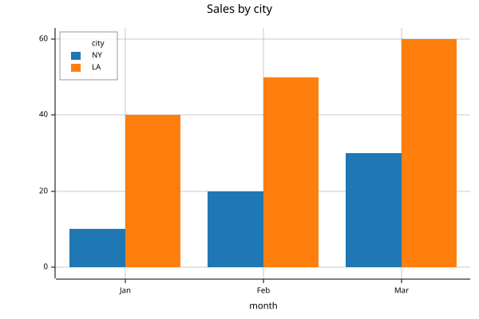
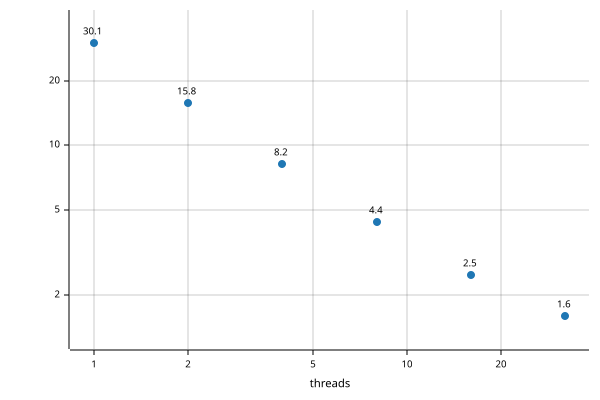

# Python


<!-- WARNING: THIS FILE WAS AUTOGENERATED! DO NOT EDIT! -->

``` python
from basedpl import bpl, fn, Array, add, tally, replicate
import numpy as np
```

## Rustymath vs BasedPL

Both packages use Rustymath’s numerical core and share leading-axis
broadcasting, Python selectors, and the `.keys` and `.names` metadata
interface. Choose Rustymath for eager numerical arrays, or BasedPL for
BPL values and composable functions.

<table>
<colgroup>
<col style="width: 33%" />
<col style="width: 33%" />
<col style="width: 33%" />
</colgroup>
<thead>
<tr>
<th></th>
<th>Rustymath</th>
<th>BasedPL</th>
</tr>
</thead>
<tbody>
<tr>
<td>Values</td>
<td>Homogeneous arrays of fixed dtype</td>
<td>Exact, mixed and nested values, functions and operators</td>
</tr>
<tr>
<td>Integer arithmetic</td>
<td>Fixed-width results can wrap</td>
<td>Ordinary exact integers can grow; explicit fixed-width integers
wrap</td>
</tr>
<tr>
<td>Execution</td>
<td>Eager numerical operations</td>
<td>Function fusion, batching and automatic differentiation</td>
</tr>
<tr>
<td>Results</td>
<td>Python scalars when all inputs are scalars</td>
<td>Native BPL values; convert explicitly with <code>.py</code> or
<code>.np</code></td>
</tr>
<tr>
<td>Out-of-range Python integer index</td>
<td><code>IndexError</code></td>
<td>The array’s fill</td>
</tr>
<tr>
<td>Function notation</td>
<td>Ordinary Python calls</td>
<td>Also currying, composition and BPL argument/axis conventions</td>
</tr>
<tr>
<td>Settings</td>
<td>Explicit Mathish functions and a process-wide thread setting</td>
<td>Process-wide preferences shared with BPL evaluation</td>
</tr>
</tbody>
</table>

Python operators return a BasedPL value when given a Rustymath array and
a BasedPL value. Converting ordinary arrays preserves supported dtypes
and labels. A value that `∂` is differentiating, or that a [batched
call](terms.qmd#term-batched-call) is running on, cannot be converted to
a Rustymath array.

Rustymath’s ordinary functions use exact comparisons. The
`rustymath.mathish` namespace provides J-inspired numerical conventions.
BasedPL enables these conventions for [Mathish
types](terms.qmd#term-mathish-types) under default dynamic kinds.
`bpl.prefs({'mathish': False})` disables them without changing the kinds
setting. [Numbers](numbers.qmd#mathish-mode) describes the comparison
and zero-division rules.

## Native arrays

`bpl` is the BPL workspace. It keeps its names for the life of the
Python process. Calling it returns a native `basedpl.Array`. The
returned array retains nesting, exact numbers and empty-array
[prototypes](terms.qmd#term-prototype). Use `.np` or `.py` to convert
it.

``` python
v = bpl('1 2 4')
v
```

    1 2 4

Python operators use BPL’s array semantics. Precedence follows Python,
which multiplies before adding:

``` python
v * 2 + 1
```

    3 5 9

Indexing counts from 0, as in Python. Negative positions count from the
end. Indexing gives the fill for a position outside the array, for a
position between whole numbers, and for a pick path that goes past the
data. These are [BPL’s indexing rules](indexing.ipynb#positions). Slices
take a start, stop and step, as Python’s do. Indexing with too many axis
selectors or more than one `...` raises `IndexError`. Iteration yields
rows of a matrix rather than individual items:

``` python
a = bpl('2 3ρι6')
a.shape, a[0, :], a[:, 1:], a[:, -1], list(a)
```

    ((2, 3),
     [0., 1., 2.],
     [[1., 2.], [4., 5.]],
     [2., 5.],
     [[0., 1., 2.], [3., 4., 5.]])

BPL also exposes functions by their word names. `add.reduce` is `+/`,
and `add.reduce.each` is `+/¨`. Applied to this nested vector, `+/¨`
sums each item:

``` python
nested = bpl('[[1 2] [3 4 5]]')
nested
```

    (1 2◇3 4 5)

In Python, chain the corresponding word functions:

``` python
add.reduce.each(nested)
```

    3 12

``` python
f = add.reduce.each
f(nested)
```

    3 12

`Array(1, 2, 4)` makes a vector, as does `Array([1, 2, 4])`. With a
single argument, `Array(3)` makes an atom rather than a vector. Python
integers become ordinary exact values. Their NumPy export uses `int64`
under dynamic kinds.

Functions compose too: `add.reduce / tally` builds the mean function
`+/÷≢`. Its result is still a native array, even when it holds a single
number:

``` python
exact = Array(1, 2, 4)
assert exact.np.dtype == np.int64
mean_native = add.reduce / tally
mean_native(exact)
```

    2ₓ

The native representation uses Python numeric notation: `2` is exact and
`2.` is approximate. `.bpl` returns the BPL display as a string:

``` python
v.bpl, exact.bpl
```

    ('1 2 4', '[1 2 4]ₓ')

## The workspace

`bpl` is shared by the whole Python process, including the [notebook
magics](notebooks.ipynb). `bpl(']clear')` removes every name and
restores the starting display settings.

Calling `bpl` returns a native array or function and prints explicit BPL
output. It suppresses implicit BPL display. Use `.np` or `.py` when you
need a converted result:

``` python
bpl('3 3ρι9').np
```

    array([[0., 1., 2.],
           [3., 4., 5.],
           [6., 7., 8.]])

Builtins are available by name as attributes of the `basedpl` module and
of `bpl`. For example, `bpl.conjugate(2+3j)` conjugates, `bpl.add(2)`
adds 2, and `bpl.multiply(2)` doubles. [Word functions](#word-functions)
explains the names:

``` python
bpl.conjugate(2+3j).py, bpl.add(2)(3).py, bpl.multiply(2)([1, 2, 3]).py
```

    ((2-3j), 5, array([2, 4, 6]))

Passing keyword arguments to `bpl` binds Python values in the workspace.
Use square brackets to evaluate a BPL expression or assign a value:

``` python
bpl(x=np.arange(1, 6))
bpl['v'] = [3,1,4,1,5]
bpl['<v'].np
```

    array([1, 1, 3, 4, 5])

`fn('...')` makes a composable, late-bound `Function` from BPL source.
It is the same as `bpl.fn('...')`. Pass one argument for a monadic call
or two for a dyadic call. The arguments retain their Python numeric
domains:

``` python
bpl('mean←{⍝ Mean of a vector\n+/ω ÷ ≢ω}')
mean = fn('mean')
mean([1,2,4]).py
```

    2

### Names and help

Type `mean?` for its comment help and `mean??` for BPL source. The same
information is available programmatically:

``` python
mean.source, bpl.names('me')
```

    ('{⍝ Mean of a vector\n+/ω ÷ ≢ω}', ['mean'])

See [names and help](introspection.ipynb) for source lookup, erasure and
inspection APIs.

`fn` is late-bound: `fn("foo")` follows later redefinitions of `foo`.
Use `bpl("foo")` to retain its current function.

Calling `bpl` prints only explicit output, from `⎕←` and display
commands. Each output is printed as soon as BPL produces it, before any
later `⎕` prompt. With `'explicit'` as its second argument, `bpl`
captures that output instead and returns a `Result` with the native
`.value` and the captured `.output`:

``` python
r = bpl('⎕←x ◇ ≥x', 'explicit', x=3)
assert r.value.py == 4
assert r.output == ['3ₓ']
```

With `'repl'`, `bpl` also captures implicit expression display, as the
BPL prompt shows it. The `%%bpl` cell magic uses `'repl'`. In ordinary
Python notebooks, append `;` to suppress display of a call’s return
value.

## Labelled arrays

``` python
data = [[10, 20, 30], [40, 50, 60]]
keys = ('NY', 'LA'), ('Jan', 'Feb', 'Mar')
sales = Array(data, keys=keys, names=('city', 'month'))
sales.names, sales.keys
```

    (('city', 'month'), (('NY', 'LA'), ('Jan', 'Feb', 'Mar')))

Use keys as selectors in the same way as positions. A slice of keys
includes its end key, as pandas’ `.loc` does. Reading a missing key
gives the fill. Using a missing key as a slice bound raises `KeyError`.
Assigning through a missing key adds it, as BPL’s `⌷` does. The
assignment below changes an `Array(sales)` copy, so `sales` keeps its
two cities:

``` python
grown = Array(sales)
grown['SF'] = 70
assert sales['SF'].py == {'Jan': 0, 'Feb': 0, 'Mar': 0} and grown.keys[0] == ('NY', 'LA', 'SF')
sales[:, 'Jan':'Feb'], sales['SF'], grown.keys
```

    (Array([[10, 20], [40, 50]], keys=[['NY', 'LA'], ['Jan', 'Feb']], names=['city', 'month']),
     Array([0, 0, 0], keys=[['Jan', 'Feb', 'Mar']], names=['month']),
     (('NY', 'LA', 'SF'), ('Jan', 'Feb', 'Mar')))

Arithmetic matches named axes and aligns their keys, rather than relying
on order. This adjustment lists the months backwards but still adds 1 to
January, 2 to February and 3 to March in each city. `.df` copies the
result to pandas, preserving labels; install pandas to use it.

``` python
months = 'Mar', 'Feb', 'Jan'
adjustment = Array(3, 2, 1, keys=(months,), names=('month',))
(sales + adjustment).df
```

<div>
<style scoped>
    .dataframe tbody tr th:only-of-type {
        vertical-align: middle;
    }
&#10;    .dataframe tbody tr th {
        vertical-align: top;
    }
&#10;    .dataframe thead th {
        text-align: right;
    }
</style>

<table class="dataframe" data-quarto-postprocess="true" data-border="1">
<thead>
<tr style="text-align: right;">
<th data-quarto-table-cell-role="th">month</th>
<th data-quarto-table-cell-role="th">Jan</th>
<th data-quarto-table-cell-role="th">Feb</th>
<th data-quarto-table-cell-role="th">Mar</th>
</tr>
<tr>
<th data-quarto-table-cell-role="th">city</th>
<th data-quarto-table-cell-role="th"></th>
<th data-quarto-table-cell-role="th"></th>
<th data-quarto-table-cell-role="th"></th>
</tr>
</thead>
<tbody>
<tr>
<td data-quarto-table-cell-role="th">NY</td>
<td>11</td>
<td>22</td>
<td>33</td>
</tr>
<tr>
<td data-quarto-table-cell-role="th">LA</td>
<td>41</td>
<td>52</td>
<td>63</td>
</tr>
</tbody>
</table>

</div>

Assign to `.keys` or `.names` to replace labels without reordering
values. Each tuple has one entry per axis. An entry of `None` marks an
unlabelled axis, and assigning `None` to `.keys` or `.names` clears all
labels. Relabelling an `Array(sales)` copy leaves `sales` unchanged:

``` python
renamed = Array(sales)
renamed.names = ('place', 'month')
renamed.keys = (('New York', 'Los Angeles'), None)
assert sales.names == ('city', 'month') and sales.keys == keys
renamed.names, renamed.keys, sales.names
```

    (('place', 'month'), (('New York', 'Los Angeles'), None), ('city', 'month'))

## Plots

`plot` draws a chart from an array. Keys label the x axis and the
legend, and axis names become the axis titles. Keyword arguments set the
chart’s options, with a dictionary for each nested option:

``` python
legend = {'position': 'top-left'}
bpl.plot(sales, mark='bar', title='Sales by city', legend=legend)
```



A dict of equal-length lists is a table. Its `x` column supplies the x
values, and every other column is a series. [Plots](plot.ipynb) lists
all the settings.

``` python
threads = [1, 2, 4, 8, 16, 32]
seconds = [30.1, 15.8, 8.2, 4.4, 2.5, 1.6]
bpl.plot({'x': threads, 'seconds': seconds}, mark='point', labels=1,
    x={'title': 'threads', 'scale': 'log'}, y={'scale': 'log'})
```



## Values and conversion

`Array` retains atoms, shape, nesting, numeric domain and empty
prototypes. An atom and a scalar both have `.shape == ()`. `.is_atom` is
`True` only for an atom. `.bpl` gives the BPL display. `.py` converts
atoms to Python values and character vectors to strings. Other arrays
become NumPy arrays, including scalars. `.np` always returns an ndarray.

For [axis-keyed arrays](keyed.ipynb), `.py` returns a dict at rank 1 and
a pandas DataFrame at higher ranks. `.np` copies the values. Attach
labels with `Array(data, keys=[rows, cols])`; use `None` for an unkeyed
axis. `.keys` returns a tuple of label tuples or `None`.

Names label dimensions, and keys label the positions within them. Axes
with matching names are aligned before positional broadcasting. `.names`
returns one name or `None` per dimension.

``` python
from basedpl import Array, add
```

``` python
m = Array([[1, 2, 3], [4, 5, 6]], names=('city', 'month'))
v = Array(10, 20, 30, names=('month',))
assert (m + v).np.tolist() == [[11, 22, 33], [14, 25, 36]]
assert add.reduce.axis('month')(m).np.tolist() == [6, 15]
assert add.reduce.axis('month')(m).names == ('city',)
```

`.df` converts any array to a DataFrame. The columns are taken from the
last axis. The rows are taken from the earlier axes, as a MultiIndex
above rank 2. Unkeyed axes are labelled from 0. A vector of columns of
one length, as `•csv` or a DataFrame’s `Array` gives, converts by
columns instead: each column keeps its dtype, and the index is taken
from its keys. Install pandas for this conversion. Pandas is imported on
demand.

Axis names become pandas index/column names, including MultiIndex level
names.

``` python
from fractions import Fraction
from basedpl import Array
```

``` python
assert Array(2).bpl == '2ₓ'
assert Array(2.).bpl == '2'
assert Array(Fraction(1, 3)).py == Fraction(1, 3)
assert Array([1, None]).bpl == '1 $n'
assert Array("x").shape == (1,) and Array({"n": "x"})["n"].shape == ()
assert Array([3, 2.5]).bpl == '3 2.5' and Array(value=3, score=2.5).bpl == '["value":3ₓ "score":2.5]'
```

<table>
<colgroup>
<col style="width: 50%" />
<col style="width: 50%" />
</colgroup>
<thead>
<tr>
<th>Python input</th>
<th>BPL value</th>
</tr>
</thead>
<tbody>
<tr>
<td><code>bool</code>, NumPy Booleans</td>
<td>Boolean</td>
</tr>
<tr>
<td><code>int</code></td>
<td><a href="numbers.qmd#weak-and-strong-numbers">Weak ordinary
integer</a>, exact under dynamic kinds</td>
</tr>
<tr>
<td>NumPy integers and typed integer buffers</td>
<td>Fixed-width integer, retaining supported dtype</td>
</tr>
<tr>
<td><code>float</code></td>
<td>Weak approximate real, at the default width</td>
</tr>
<tr>
<td><code>Fraction</code></td>
<td>Exact rational</td>
</tr>
<tr>
<td><code>complex</code></td>
<td>Weak approximate complex</td>
</tr>
<tr>
<td><code>None</code> as an item of a list, dict or frame</td>
<td>NaN, <code>$n</code>. A bare <code>None</code> doesn’t convert</td>
</tr>
<tr>
<td><code>str</code></td>
<td>Character vector. Inside a list, tuple or dict, a one-character
string is a character atom: <code>["a", "b"]</code> gives
<code>"ab"</code>. The strings of one conversion that repeat a text
share one character vector</td>
</tr>
<tr>
<td>Rectangular list/tuple/<code>range</code></td>
<td>Ordinary array</td>
</tr>
<tr>
<td>Ragged list/tuple</td>
<td>Nested array</td>
</tr>
<tr>
<td>NumPy ndarray or <code>__array__</code> provider</td>
<td>Array preserving shape and numeric domain</td>
</tr>
<tr>
<td><code>dict</code> with string keys</td>
<td><a href="keyed.ipynb">Keyed vector</a>, recursively.
<code>.py</code> returns a <code>dict</code></td>
</tr>
<tr>
<td>pandas DataFrame</td>
<td>Keyed vector of its columns, as <code>•csv</code> gives. The index
keys each column where every label is a string</td>
</tr>
</tbody>
</table>

NumPy float and complex scalars keep their explicit widths and are
strong, including inside sequences beside weak Python floats or complex
numbers. An exact number that the float type cannot represent exactly
stays exact, and the array is then mixed. A list’s items combine under
BPL’s usual joining rules: `[1, 2.5]` gives two floats. Each of a dict’s
values keeps its kind, as a record’s fields do. In
`{"name": "x", "age": 3, "score": 2.5}`, `age` stays exact beside the
float `score`. Its `name` is the character atom `'x'`.

`.np` or `np.asarray(a)` always produces an ndarray. Booleans use
`bool`. Fixed-width integers keep their selected dtype: `uint8`,
`int16`, `int32` or `int64`. Ordinary integers that fit signed 64 bits
use `int64` under dynamic kinds, and at least the `int` preference’s
computation width under static kinds. Floats use `float16`, `float32` or
`float64`; complex arrays use `complex64` or `complex128`. Fractions,
large integers, nested arrays and mixed exact and approximate values use
`object`. Character arrays use `U1`. The arrays inside a `.py` result,
and the columns of a `.df` result, use the same dtypes.

``` python
import numpy as np
from numpy.testing import assert_array_equal
```

`range` works on its own or inside a rectangular sequence. Objects with
`__array__`, such as a pandas Series, also convert. The numeric values
are converted without pandas labels:

``` python
a = Array([range(1, 4), range(4, 7)])
assert_array_equal(a.np, [[1, 2, 3], [4, 5, 6]])
```

``` python
assert_array_equal(Array(sales.df.loc['NY']), [10, 20, 30])
Array(sales.df.loc['NY'])
```

    [10 20 30]ₓ₈

A pandas DataFrame becomes a keyed vector of its columns, as `•csv`
gives, so each column keeps its kind. If every index label is a string,
the index supplies the keys for each column’s rows. `.df` gives the
frame back:

``` python
import pandas as pd
```

``` python
orders = pd.DataFrame({'item': ['tea', 'cake'], 'qty': [2, 5], 'price': [3.5, 4.25]}).set_index('item')
t = Array(orders)
assert t.df.equals(orders)
t
```

    ["qty":["item":2]ρ["tea":2 "cake":5]ₓ₈ "price":["item":2]ρ["tea":3.5 "cake":4.25]]

`.py` and `.np` copy the data. Foreign buffer exporters, including a
`memoryview` or an `array.array`, supply shape and numeric items but no
labels. Conversions between Rustymath and BasedPL arrays also preserve
`.keys` and `.names` in either direction, without going through NumPy.
Rustymath cannot represent BPL’s nested, mixed or arbitrary exact
values; convert those explicitly before passing them.

`np.asarray(a, copy=False)` gives a read-only view when the storage
already has the requested export dtype. If converting the dtype requires
a copy, `np.asarray(a, copy=False)` raises an error. Under dynamic
kinds, ordinary integer storage narrower than 64 bits needs widening to
`int64` for export. A [pending](terms.qmd#term-pending) window, reversal
or drop is exported as strides over its source’s items, and its own
items are never built. A pending reversal is exported with a negative
stride.

`a.own()` returns the same ndarray as `a.np`, moving compatible storage
instead of copying when nothing else holds it, as for a fresh result.
Afterwards `a` holds nothing, and using it raises `ValueError`. Passing
an `Array` back to BPL shares its value until either owner is updated.
Keep values as `Array` objects to preserve empty prototypes and exact
nesting.

An `Array` result can be [pending](terms.qmd#term-pending). `a.force()`
computes pending items throughout nested arrays and returns `a` without
conversion or ownership transfer. Include it in Python benchmarks:
`%timeit calculation().force()`. `bpl.storage(a)` reports pending work
without reading items; `bpl.storage.each(table)` inspects each column.
Checking an array’s `.shape` does not compute pending items.

`rm.array` and `Array` preserve labels on ordinary arrays. Python
operators return an `Array` when mixing Rustymath and BasedPL:

``` python
import rustymath as rm
```

``` python
rusty_sales = rm.array(sales)
roundtrip = Array(rusty_sales)
assert roundtrip.names == sales.names and roundtrip.keys == sales.keys
assert_array_equal(roundtrip, sales)
assert isinstance(rusty_sales + sales, Array)
assert isinstance(sales + rusty_sales, Array)
rusty_sales, roundtrip.names, roundtrip.keys
```

    (Array([[10, 20, 30], [40, 50, 60]], dtype=int64, keys=(('NY', 'LA'), ('Jan', 'Feb', 'Mar')), names=('city', 'month')),
     ('city', 'month'),
     (('NY', 'LA'), ('Jan', 'Feb', 'Mar')))

### Fixed-width integers

NumPy integer buffers retain their fixed type in BPL. Arithmetic and
reduction wrap at that type. With a wider typed seed, `reduce` uses a
wider accumulator: `add.reduce(np.int64(0), pixels)` is `0ₓ₈+/pixels`.
The native sum reads the bytes directly rather than building a widened
input array. `pixels.exact` removes the fixed-width type without copying
the data, so operations on it use ordinary integer arithmetic:

``` python
pixels = Array(np.array([200, 100], dtype=np.uint8))
wrapped = add.reduce(pixels)
ordinary = add.reduce(pixels.exact)
wide = add.reduce(np.int64(0), pixels)
assert [wrapped.py, ordinary.py, wide.py] == [44, 300, 300]
assert wide.np.dtype == np.int64
wrapped.bpl, ordinary.bpl, wide.bpl
```

    ('44ₓ₁', '300ₓ', '300ₓ₈')

The accumulator takes the wider of the seed’s type and the input’s type,
so a seed cannot narrow wider input. Passing a Python `0` as the seed
does not widen the accumulator to `int64`. Converting the width after
reduction cannot recover a total that wrapped.
[Numbers](numbers.qmd#fixed-width-integers) gives the numeric promotion
and conversion rules. See [Reduce](glyphs/slash.qmd) for the BPL
spelling.

Python `int` arguments are weak. `Array(100)` preserves that weakness.
An integer selected from `Array([100])` is strong. The last addition
below uses ordinary arithmetic:

``` python
(pixels + 100).bpl, (pixels + Array(100)).bpl, (pixels + Array([100])[0]).bpl
```

    ('[44 200]ₓ₁', '[44 200]ₓ₁', '[300 200]ₓ')

The properties `.uint8`, `.int16`, `.int32`, `.int64`, `.float16`,
`.float32` and `.float64` convert an array to that type. `.exact` gives
ordinary integers. These match BPL’s [numeric
suffixes](scripts.ipynb#subscripts). Adding one of these type properties
to a function converts its result after computation:

``` python
pixels.int32, add.reduce.int32(pixels)
```

    ([200, 100], Array(44))

## Array operations

Arithmetic aligns leading axes. Indexing starts at 0, and negative
positions count from the end. Slices work as in Python. `...` keeps all
remaining axes. `None` inserts an unnamed, unkeyed length-one axis
without consuming an input axis, as `¯∞` does in [BPL
indexing](glyphs/squad.qmd). Python `:` and `...` correspond to BPL `:`
and `∞`:

``` python
assert_array_equal(a + [10, 20], [[11, 12, 13], [24, 25, 26]])
assert_array_equal(a[1, :], [4, 5, 6])
assert_array_equal(a[:, [0, 2]], [[1, 3], [4, 6]])
assert_array_equal(a[:, -1], [3, 6])
assert_array_equal(a[:, ::-1], [[3, 2, 1], [6, 5, 4]])
assert_array_equal(a[..., 0], [1, 4])
assert a[:, None, :].shape == (2, 1, 3)
assert a[None, ..., None].shape == (1, 2, 3, 1)
a[:, None, :].shape, a[None, ..., None].shape
```

    ((2, 1, 3), (1, 2, 3, 1))

A path array selects rows inside nested matrices. The selected cells
must have matching shapes. Slices, `None` and `...` can follow the path
array for reading and assignment:

``` python
matrices = bpl('[[1 2 3◇4 5 6] [7 8 9◇10 11 12]]')
row_paths = bpl('[[0 1] [1 0]]')
rows = matrices[row_paths, ..., None]
matrices[row_paths, ..., None] = rows * 10
rows.shape, matrices[row_paths, 1:]
```

    ((2, 3, 1), [[50., 60.], [80., 90.]])

Comparisons return arrays. `%` uses Python’s operand order and `//` is
floor division. Array `@` applies BPL’s `+.ײ`. It multiplies vectors
and matrices, broadcasting leading batch axes.

Array `&`, `|` and `~` require Boolean or integer inputs and perform
bitwise AND, OR and NOT. Their BPL counterparts use
[Bitwise](glyphs/superscript-b.qmd) `ᵇ`: `∧ᵇ`, `∨ᵇ` and `~ᵇ`. Plain `∧`
and `∨` still compute LCM and GCD.

``` python
bits = Array(6, 3)
assert bpl.match(bits & 5, [4, 1]).py
bits & 5, bits | 5, ~bits
```

    ([4, 1], [7, 7], [-7, -4])

`abs` gives magnitudes. Python indexing uses BPL’s indexing rules, so a
Boolean vector is treated as positions 0 and 1. To keep the items where
a mask is true, use `replicate`, BPL’s [`#`](glyphs/hash.qmd). Indexing
with an empty list selects no positions.

``` python
values = Array(-3, 2, -1, 4)
magnitudes = abs(values)
assert bpl.match(replicate(values > 0, values), [2, 4]).py
magnitudes, replicate(values > 0, values)
```

    ([3, 2, 1, 4], [2, 4])

`len`, iteration and `in` use major cells: items of a vector, rows of a
matrix. `in` compares the whole query with each major cell, using native
tolerant matching. `in` returns `False` when the query has the wrong
rank or cell shape. `in` treats a string as one item when the array’s
items are strings, and as a row when the array is a character matrix.
Keys don’t change value membership. Inspect `.keys` to search labels.
Atoms and rank-0 arrays are not iterable.

With exactly one item, `bool(a)` uses that item’s truth value. Calling
`bool(a)` on an array with zero or multiple items raises `ValueError`.

``` python
assert [1, 2, 3] in a and 3 not in a
letters = Array('abc')
assert 'a' in letters and 'z' not in letters and 'ab' not in letters and Array('a') not in letters
assert 'ab' in Array('ab', 'cd') and 'ef' not in Array('ab', 'cd') and 'cd' in bpl('2 2ρ"abcd"')
2 in values, [1, 2, 3] in a, 3 in a
```

    (True, True, False)

Assignment replaces the values held by the Python `Array` object.
Earlier selections, `Array(a)` copies and functions that captured its
value remain unchanged. The same selectors, including `None`, work for
reading and assignment:

``` python
previous = Array(values)
selection = values[::2]
values[None, ::2] = [[-30, -10]]
assert_array_equal(previous, [-3, 2, -1, 4])
assert_array_equal(selection, [-3, -1])
previous, values
```

    ([-3, 2, -1, 4], [-30, 2, -10, 4])

[Under](glyphs/at.qmd) applies a function at selected positions and
returns a new array without changing its argument:

``` python
updated = bpl.multiply(10).under([0, 2])(previous)
previous, updated
```

    ([-3, 2, -1, 4], [-30, 2, -10, 4])

Join a sequence of arrays with `catenate.reduce(parts)`:

``` python
joined = bpl.catenate.reduce([[1, 2], [3], [4, 5]])
assert bpl.match(joined, [1, 2, 3, 4, 5]).py
joined
```

    [1 2 3 4 5]ₓ

## Callable functions

A function made by `fn('...')` is callable. One argument supplies `ω`,
and two supply `α` and `ω`. Each argument is converted to a BPL value
and passed to the function, without being written into BPL source or
bound to a name. Integer division rounds down, so the integer mean below
is 2; floating-point inputs give a floating-point mean.

``` python
mean = bpl.fn('{+/ω ÷ ≢ω}')
assert mean([1, 2, 4]).py == 2
assert mean([1., 2., 4.]).py == 7 / 3

add = bpl.fn('+')
assert_array_equal(add([1, 2, 3], 10), [11, 12, 13])
```

A Python `int`, `float` or `complex` passed to a BPL function is weak,
as NumPy treats Python scalars, and so is a float or complex literal in
BPL code. A weak number takes the width of the arrays beside it:
`add(x, 2.0)` keeps a 32-bit `x` at 32 bits, and so does `+2.0` in BPL.
A literal with a width marker, such as `2.0ₚ`, is strong, as
`np.float64(2.0)` is in NumPy, and widens 32-bit floats to 64 bits:

``` python
x = np.array([1.5, 2.5], dtype=np.float32)
assert add(x, 2.0).np.dtype == np.float32
assert bpl['(32•float 1.5 2.5)+2.0'].np.dtype == np.float32
assert bpl['(32•float 1.5 2.5)+2.0ₚ'].np.dtype == np.float64
```

`bpl.fn('g')` follows later redefinitions of `g`. `bpl('g')` returns the
function that `g` holds now.

``` python
import basedpl as b
```

Calling a function with only keyword arguments passes a single record.
Element functions treat that record as attributes of an element with no
children. With positional arguments, keywords supply `α` and the
positional arguments form `ω`. One positional value stays as it is;
several form a vector:

``` python
circle = b.element('circle')
orange = circle(cx=30, cy=50, r=20, fill='orange')
blue = circle(cx=70, cy=50, r=20, fill='steelblue')
pic = b.svg(orange, blue, width=200)
pic
```


System functions read keyword arguments as options. `prefs` takes one
keyed argument; `json` takes its options on the left of its text:

``` python
assert b.prefs(threads=1)['threads'].py == 1
b.xml.undo(circle(r=10)), b.json('{"a": null}', fill=0)
```

    ('<circle r="10"/>', {'a': 0})

CSV options work the same way. `nget` and `nput` read and write files,
as in `b.nput(text, path='copy.csv')`:

``` python
table = b.csv('price,qty\n10.5,2\n20.0,4\n')
text = b.csv.undo(table, separator=';').py
b.csv(text, separator=';').py
```

    {'price': array([10.5, 20. ]), 'qty': array([2, 4])}

Set `ifill` to keep missing integers exact, and `fills` for
column-specific replacements. With `types`, read postcodes as text to
preserve leading zeros. Bind the options before composing CSV parsing
with file reading:

``` python
from basedpl import atop, csv, nget
```

``` python
csv_options = dict(ifill=0, fills=dict(id=-1, postcode='unknown'), types=dict(postcode=''))
read_csv = atop(csv_options | csv, nget)
typed_csv = csv('''id,qty,price,postcode
7,3,1.5,02134
,,,
''', **csv_options)
assert typed_csv['qty'].np.dtype == np.int64 and np.isnan(typed_csv['price'].np[1])
assert typed_csv['id'].np.tolist() == [7, -1] and typed_csv['postcode'].py.tolist() == ['02134', 'unknown']
typed_csv.py
```

    {'id': array([ 7, -1]),
     'qty': array([3, 0]),
     'price': array([1.5, nan]),
     'postcode': array(['02134', 'unknown'], dtype=object)}

`read_csv('sales.csv')` reads a file with these options.
[CSV](data.ipynb#csv) lists all options.

`r` returns a keyed table of regex matches in a string, whose columns
can be indexed by name. `replace` replaces the matches:

``` python
m = b.r('ab12 cd34', r'([a-z]+)([0-9]+)')
m['text'], m['position'], b.replace('ab12', [r'([a-z]+)([0-9]+)', '$2:$1'])
```

    (['ab12', 'cd34'], [0, 5], '12:ab')

[Function vectors](arrays.ipynb#functions-in-arrays), such as `[+ × ÷]`,
keep their functions callable. Indexing a function vector at a single
position, or calling `first` or `pick`, returns the selected function:

``` python
from basedpl import first, pick
```

``` python
fs = bpl('[+ × ÷]')
assert pick(1, fs)(2, 3).py == 6
assert first(fs)(2, 3).py == 5
```

`Array(f, g)` constructs a function vector. Keyword arguments construct
a record, as in `Array(mean=mean, count=tally)`. Passing both positional
arguments and record keyword arguments to `Array` raises `TypeError`.
`keys` and `names` are reserved for axis metadata; use a dict for record
fields with those names. `.py` and object-dtype `.np` export a function
vector’s items as Python callables.

An array that holds a function as an item is a `FunctionArray`. Calling
a `FunctionArray` calls each of its functions on the whole arguments, as
`aggs data` does in BPL, and leaves non-function items unchanged in the
result. An array that holds no function isn’t callable, so `callable`,
which pandas and other libraries check before calling an argument,
treats it as data:

``` python
from fastcore.test import expect_fail
```

``` python
aggs = Array(mean=mean, count=tally)
assert callable(aggs) and not callable(Array(1, 2, 4))
aggs([1, 2, 4])
```

    ["mean":2 "count":3]ₓ

``` python
with expect_fail(TypeError): Array(1, count=3)
```

`data >> aggs` also calls `aggs`. `.fn` returns the array as a
`Function`, which supports operators and composition. Here Rank calls it
on each row of a matrix:

``` python
assert ([1, 2, 4] >> aggs).py == aggs([1, 2, 4]).py
aggs.fn.rank(1)([[1, 2, 4], [3, 3, 3]])
```

    ₓ mean count
         2     3
         3     3

`f.source` shows a function’s BPL spelling. For a function constructed
from Python parts, evaluating this text does not always rebuild the
function. A native function with no BPL spelling, such as a generator’s
`roll`, prints as `⟨…⟩`, and a number prints the same whether it is
[weak or strong](numbers.qmd#weak-and-strong-numbers). Keep the function
object to keep those values. The single-string `fn('...')` form still
takes BPL source.

`f.inspect()` returns the source and help. `bpl.names(prefix, classes)`
returns the sorted visible names that start with `prefix` and have a
[name class](system/nc.qmd) in `classes`: 2 for values, 3 for functions
and 4 for operators, all three by default. `bpl.inspect(name)` returns
the `kind`, `source` and `help` of a name or glyph without evaluating
it, or `None` when the name is absent. IPython supports `f?`, `f??` and
name completion in `bpl` strings. See [names and
help](introspection.ipynb).

A user operator comes back as an `Operator`, whether it’s a workspace
name or a field of a record from `•load`. Call it with its operand, or
both operands of a dyadic operator, to get a `Function`. Bind an
`Operator` like any other value:

``` python
bpl('again←{⍶ ⍶ ω}')
again = bpl.again
assert again(bpl.fn('≥'))(3).py == 5
bpl['repeat'] = again
assert bpl('-repeat 3').py == 3
again
```

    {⍶ ⍶ ω}

## Expressions from Python parts

A single string passed to `fn` is BPL source. Otherwise, pass functions,
operators, numbers, strings, lists, tuples and `Array` values as
expression parts. BPL parses and evaluates the expression when you
construct it. A result that is a function stays callable; an expression
containing `α` or `ω` (`alpha` or `omega`) builds a dfn.

Numbers keep the Python API’s convention: `1` is the weak machine
integer `1ₓ`, and `1.` is the approximate BPL number `1`. An `Array`
passes its existing native value unchanged. Tuples group an expression
as parentheses do:

``` python
from basedpl import plus, minus, times, divide, square, sqrt, α, ω, alpha, omega, space, dot, diamond, guard, otherwise, superscript, subscript
```

``` python
assert fn(1, divide, 2).py == 0
assert fn(1., divide, 2.).py == 0.5
fn((1, plus, 1), divide, 2)
```

    1ₓ

Lists spell BPL brackets. Nested lists remain nested arrays; they do not
automatically become a matrix. For matrix data, supply
`Array([[1, 2], [3, 4]])`. `diamond` separates rows inside brackets, and
`otherwise` (`;`) separates expression items. A tuple makes one grouped
expression item.

When `fn` is called with multiple parts, strings are treated as
character data rather than variable names or BPL source. Wrap a single
string in `Array` to pass it to `fn` as data rather than BPL source:

``` python
matrix = fn([1, 2, diamond, 3, 4])
assert matrix.shape == (2, 2)
assert fn([[1, 2], [3, 4]]).shape == (2,)
assert fn("ab", b.catenate, "cd").py == 'abcd'
assert fn(Array("abc")).py == 'abc'
assert fn(matrix, dot, [1, 0]).py == 3
matrix
```

    [1 2
     3 4]ₓ

Python commas separate parts without ending a BPL run. `space` ends the
run explicitly. `fn(plus.reduce, divide, tally)` builds `+/÷≢`; adding
`space` before data applies that whole train. An already-built function
can be passed as one part without adding `space`.

Function attributes append functions to a train.
`plus.reduce.divide.tally` builds the three-part train `+/÷≢`.

An operator attribute applies to the whole function built so far. In
`sqrt.plus.reduce`, `.reduce` applies to the two-function train `√+`.
The full chain `sqrt.plus.reduce.divide.tally` means `√+ /÷≢`,
equivalently `(√+)/÷≢`: reduce with `√+`, then divide by the count.

Calling a function with one function argument composes the functions.
`sqrt(plus.reduce / tally)` means `√+/÷≢`, the square root of the mean.
On `[4., 4.]`, `sqrt(plus.reduce / tally)` gives `2`, while
`sqrt.plus.reduce.divide.tally` gives `√2`.

``` python
mean_train = plus.reduce.divide.tally
assert mean_train([2., 4., 9.]).py == 5.
assert fn(plus.reduce, divide, tally, space, [2., 4., 9.]).py == 5.
composed = sqrt(plus.reduce / tally)([4., 4.])
chained = sqrt.plus.reduce.divide.tally([4., 4.])
assert b.match([composed, chained], [2., sqrt(2.)]).py
composed, chained
```

    (Array(2.0), Array(1.4142135623730951))

``` python
bpl('(√+/÷≢)4 4')
```

    2

``` python
bpl('2 2')
```

    2 2

`α` and `ω` stand for the arguments of a dfn. Their word names `alpha`
and `omega` work too. Arithmetic on expression parts builds syntax using
Python’s precedence: `fn(α-ω, divide, α)` and `fn((α-ω)/α)` both build
`{(α-ω)÷α}`. The first mixes a prepared subtraction with a BPL function
part; the second uses Python arithmetic for the whole expression.

In a function already built by `fn` and used as a part of another
expression, `α` and `ω` are the arguments of that function’s call, not
those of the outer expression. Python assignment names a value or
function. For a BPL local variable computed once per invocation, use the
source-string form with `←`.

This root-mean-square percentage error first computes the relative
error, then takes its RMS:

``` python
err = fn(α-ω, divide, α)
err_compact = fn((α-ω)/α)
rms = mean_train.under(square)
rmspe = fn(rms, err)
assert b.match(err([2., 4.], [1., 2.]), err_compact([2., 4.], [1., 2.])).py
assert rmspe([2., 4.], [1., 2.]).py == 0.5
rmspe([2., 4.], [1., 2.])
```

    0.5

`guard` (`?`) and `otherwise` (`;`) select a dfn body. `diamond` (`◇`)
separates statements; the last statement supplies the result. Pass a
derived function as one part, such as `plus.reduce`, or as separate
parts, such as `plus, b.reduce`.

``` python
magnitude = fn((omega, b.less, 0), guard, minus, omega, otherwise, omega)
assert magnitude(-3).py == 3
last = fn(omega, plus, 1, diamond, omega, times, 2)
assert last(3).py == 6
assert fn(plus, b.reduce, [1, 2, 3]).py == 6
```

`superscript` and `subscript` follow BPL’s contextual meanings.
`superscript(2)` squares data but selects Rank 2 after a function.
`superscript(1, 2)` selects left Rank 1 and right Rank 2. A negative
superscript on data gives a reciprocal power, while a negative
superscript on a function selects a relative Rank. `f.undo` gives the
function inverse.

A numeric subscript selects an item from data or an axis for a function.
`subscript(1, 2)` selects coordinate `[1 2]`, not item 2 of item 1. The
unique prefixes `b.sup` and `b.subs` are available too:

``` python
squared = fn(omega, superscript(2))
second = fn(omega, subscript(1))
assert b.match(squared([2, 3]), [4, 9]).py
assert second([10, 20, 30]).py == 20
fn(plus.reduce, superscript(1), matrix)
```

    [3 7]ₓ

## Word functions

Each builtin function has a Python name for each valence, such as `add`,
`subtract`, `multiply` and `divide`, plus its glyph name, such as `plus`
and `times`. The names are attributes of `basedpl` and `bpl` and can be
imported from `basedpl`. A valence name selects one valence. Called with
one argument, a dyadic name binds the right argument. `f | x` binds the
right argument explicitly, and `x | f` binds the left argument. A glyph
name gives the function with both valences, as `fn('+')` does.

``` python
from basedpl import add, multiply, subtract, tally, conjugate, pi_times
```

``` python
assert multiply(2)(3).py == 6
assert subtract(2)(5).py == 3       # 5−2
assert (2 | subtract)(5).py == -3 # 2−5
assert subtract.unary(10, 3).py == -3

mean = add.reduce / tally
assert mean([1, 2, 4]).py == 2
```

``` python
assert conjugate(2).py == 2
assert b.divide(2)(3).py == 1
assert pi_times(1).py == np.pi
```

Attribute lookup on `basedpl` or `bpl` accepts a glyph, a glyph name or
a valence name. Use underscores for hyphenated names, as in
`circle_star`, and a trailing underscore for Python keywords, as in
`not_`. A glyph that is a legal Python identifier, such as `π`, works
directly. Get other glyphs with `getattr(bpl, '+')`. System functions
can be looked up without their leading `•`. Exact names take precedence
over abbreviations. A unique prefix resolves to its full name: `b.plu`
means `b.plus`, and `b.subs` means `b.subscript`. Looking up an
ambiguous prefix raises `AttributeError`, which lists its matches.
`dir(b)` and `dir(f)` list full names for Jupyter completion, including
operator properties such as `reduce` and `reduce_first`.

A workspace name is also an attribute of `bpl` when no builtin has that
name. After `add←99`, `bpl.add` is still the builtin, and `bpl['add']`
gives 99. `dir(basedpl)` lists the builtins, and `dir(bpl)` also lists
workspace names.

``` python
assert bpl.multiply(2, 3).py == 6
assert bpl.index_of([4, 2, 7], [7, 4]).py.tolist() == [2, 0]
assert getattr(bpl, '+')(2, 3).py == 5
assert bpl.conjugate(1+2j).py == 1-2j
assert bpl.add(2)(3).py == 5
assert bpl.sign(-2).py == -1
assert bpl.multiply(2)(3).py == 6
assert bpl.distribution('normal')['cdf'](0.).py == 0.5
```

Names distinguish valences: `sign`/`multiply`, `shape`/`reshape`,
`indices`/`index_of`, `first`/`take`, `mix`/`pick`. A glyph name keeps
both valences, so `times(-2)` gives the sign of -2, and `times(2, 3)`
gives 6. `multiply(2.)` binds an approximate number, and `multiply(2)`
binds an exact one. An operator property on a valence name applies to
the glyph’s whole function: `sign.reduce` is `×/`.

`exponential` and `exponent` name the monadic and dyadic forms of `*`.
`power` names the operator `⍣`, exposed as `f.power(n)`.

`basedpl.symbols` is the shared naming table used by Python functions
and REPL and notebook completion. Each row is a dict with the keys
`glyph`, `name`, `kind`, `monad`, `dyad`, `monad_rank`, `dyad_ranks`,
`hanzi` and `shortcut`. `name` is the glyph name, which names the
character and the glyph’s reference page. `kind` is one of `function`,
`monadic-operator`, `dyadic-operator`, `argument`, `literal`, `comment`,
`system` or `syntax`. `monad` and `dyad` hold the names for what the
glyph does: a function’s monadic and dyadic names, or an operator’s
names for its derived function’s valences. They hold `""` where there’s
no name for that valence. An operator whose valences do the same thing
has its one name in `monad`, as does every other glyph with a name.
`monad_rank` and `dyad_ranks` give a function’s natural ranks as BPL
text, such as `1` or `1 ∞`, where `∞` is the whole argument. `hanzi`
holds two strings of single-character Hanzi spellings, simplified then
traditional, each with its preferred spelling first. `shortcut` is the
REPL’s formatted key suffix, derived from `layout.json`: `" h"` for
Alt-h, `" o c"` for Alt-o then c, or `""` when absent. The table is
directly JSON-serializable for JavaScript consumers.

Every operator also has a property named by its glyph name, which gives
the derived function with both valences: `f.tilde_diaeresis` is `f⍨`,
and `f.slash` is `f/`. The table below lists the operator properties
named for what each operator does.

<table>
<colgroup>
<col style="width: 50%" />
<col style="width: 50%" />
</colgroup>
<thead>
<tr>
<th>Python</th>
<th>BPL</th>
</tr>
</thead>
<tbody>
<tr>
<td><code>f.reduce</code>, <code>f.scan</code>,
<code>f.reduce_first</code>, <code>f.scan_first</code></td>
<td><code>f/</code>, <code>f\</code>, <code>f⌿</code>,
<code>f⍀</code></td>
</tr>
<tr>
<td><code>f.each</code>, <code>f.self</code>,
<code>f.commute</code></td>
<td><code>f¨</code>; <code>f⍨</code> with one argument; <code>f⍨</code>
with two</td>
</tr>
<tr>
<td><code>f.bitwise</code></td>
<td><code>fᵇ</code>, a Boolean function applied to integer bits</td>
</tr>
<tr>
<td><code>f.unary</code></td>
<td><code>fᵘ</code>, called with its right argument alone, ignoring any
left argument</td>
</tr>
<tr>
<td><code>f.outer_product</code>, <code>f.determinant(g)</code>,
<code>f.inner_product(g)</code></td>
<td><code>f⊗</code>; <code>f.g</code> with one argument;
<code>f.g</code> with two</td>
</tr>
<tr>
<td><code>f.key</code>, <code>f.stencil(s)</code></td>
<td><code>f⌸</code>, <code>f⌺s</code></td>
</tr>
<tr>
<td><code>f.rank(r)</code>, <code>f.atop(g)</code></td>
<td><code>f⍤r</code>, <code>f∘g</code></td>
</tr>
<tr>
<td><code>f.after(g)</code>, <code>f.over(g)</code>,
<code>f.before(g)</code></td>
<td><code>f↢g</code>, <code>f⍥g</code>, <code>f↣g</code></td>
</tr>
<tr>
<td><code>f.power(n)</code>, <code>f.power(g)</code>,
<code>f.power([g])</code></td>
<td><code>f⍣n</code>, with <code>n</code> a count, a list of counts or
<code>∞</code>; <code>f⍣g</code>, which computes counts once;
<code>f⍣[g]</code>, which keeps the history until <code>g</code></td>
</tr>
<tr>
<td><code>f.undo</code>, <code>f.undo(g)</code>,
<code>f.under(g)</code>, <code>f.under([p])</code></td>
<td><code>f⁻</code>; <code>f</code> with the inverse <code>g</code>, as
<code>f⁻←g</code> attaches it; <code>f@g</code> for selection or
transformation; <code>f@[p]</code> for a mask</td>
</tr>
<tr>
<td><code>f.valences(g)</code></td>
<td><code>f⊘g</code>: <code>f</code> with one argument, <code>g</code>
with two</td>
</tr>
<tr>
<td><code>f.agenda(g)</code></td>
<td><code>f⍚g</code>: the result of <code>f</code> picks which function
in the vector <code>g</code> runs, on the whole argument or on each
cell</td>
</tr>
<tr>
<td><code>f.derivative</code>, <code>f.derivative(g)</code></td>
<td><code>f∂</code>, the Jacobian, which with two arguments
differentiates with respect to the right one; <code>f</code> with the
derivative <code>g</code>, as <code>f∂←g</code> attaches it</td>
</tr>
<tr>
<td><code>f.axis(k)</code></td>
<td><code>f⍠k</code>, axes <code>k</code></td>
</tr>
<tr>
<td><code>f[i]</code></td>
<td><code>f.[i]</code>, selection from the result of <code>f</code></td>
</tr>
<tr>
<td><code>f.optimize(x, lower=l)</code></td>
<td><code>["lower":l] f⇄ x</code></td>
</tr>
</tbody>
</table>

Use `f.power(enclose(Array(g)))` for the stopping predicate `f⍣gˢ`.
Calling `enclose(g)` with a function would compose the two functions
instead.

Operator properties chain in BPL order: `subtract.commute.reduce` is
`-⍨/`. An operator that needs another operand keeps that operand’s place
open until it is supplied:

``` python
twice = multiply(2)
assert twice.power.each(3)([1, 2]).py.tolist() == [8, 16]  # twice⍣3¨
```

`f.power.each(n)` constructs `f⍣n ¨` (equivalently `(f⍣n)¨`), just like
`f.power(n).each`. For multiple missing operands, successive calls fill
the innermost construction first: `f.power.each.power(n)(m)` constructs
`f⍣n ¨⍣m`. Supply all operands before passing arguments to evaluate the
function.

Arithmetic between functions makes forks: `f+g` is `(f+g)`. `f @ g` is
inner product. `f << g` is the Atop `f∘g`, and `f >> g` is `g∘f`.
`f ** n` is Power. `atop(f, g, h)` is `f << g << h`; it accepts two or
more functions. Use `fork(f, g, h)` for a fork. `value >> (f >> g)`
calls the composed function once. `value >> f >> g` makes separate calls
and misses whole-composition optimizations. `|` binds arguments to
functions; array `|` remains bitwise OR. Python’s precedence applies
when building these expressions:

``` python
assert b.atop(b.floor, b.multiply(10.), b.add(1.))(1.25).py == 22
double = b.times | 2
assert double(3).py == 6
[6, 3] >> (double >> b.add.reduce)
```

    18ₓ

`f[selectors]` selects from the result of `f`. It accepts the same
positions, keys, slices, `None` and `...` as Array indexing. Selectors
are captured when the function is constructed; slice bounds resolve
against each call’s actual result. Use `f.axis(axes)` to apply `f` along
chosen axes instead:

``` python
tail = b.same[1:]
assert b.match(tail([1, 2, 3]), [2, 3]).py
assert b.match(tail([4, 5, 6, 7]), [5, 6, 7]).py
tail(sales)
```

     ₓ Jan Feb Mar
    LA  40  50  60

To sample rows from a table, draw the row positions once, then apply the
same selector to every column with Each. Drawing inside Each would
sample each column independently and break the row relationships. Here
`t` is the keyed vector of columns imported from `orders` above; `t[0]`
is its first column.

`[positions] | b.index` binds the selector `[positions]` as the left
argument of `⌷`. The enclosing list keeps it as a selector for one axis:

``` python
positions = b.deal(1, tally(t[0]))
sampled = ([positions] | b.index).each(t)
assert sampled.keys == t.keys and tally(sampled[0]).py == 1
sampled.df
```

<div>
<style scoped>
    .dataframe tbody tr th:only-of-type {
        vertical-align: middle;
    }
&#10;    .dataframe tbody tr th {
        vertical-align: top;
    }
&#10;    .dataframe thead th {
        text-align: right;
    }
</style>

<table class="dataframe" data-quarto-postprocess="true" data-border="1">
<thead>
<tr style="text-align: right;">
<th data-quarto-table-cell-role="th"></th>
<th data-quarto-table-cell-role="th">qty</th>
<th data-quarto-table-cell-role="th">price</th>
</tr>
<tr>
<th data-quarto-table-cell-role="th">item</th>
<th data-quarto-table-cell-role="th"></th>
<th data-quarto-table-cell-role="th"></th>
</tr>
</thead>
<tbody>
<tr>
<td data-quarto-table-cell-role="th">cake</td>
<td>5</td>
<td>4.25</td>
</tr>
</tbody>
</table>

</div>

Math families: `prime`/`prime_mode` (`⍭`), `factors`/`factor_spec`
(`⨸`), `roots`/`polyval` (`⌻`). `windows` is dyadic `↕`.

Roots: `sqrt`/`root` (`√`). Complex coordinates: `real_imag` (`∨`),
`polar` (`∧`), `cis` (`○`). `pi_times`/`pi_ratio` (`π`) multiply/divide
by π. Also `square`, `double`, `decrement`, `increment`, `classify`,
`binary_encode` and `binary_decode`.

``` python
from basedpl import prime, factors, polyval
```

``` python
assert prime(9).py == 29
assert_array_equal(factors(700), [2, 2, 5, 5, 7])
p = [1, 2, 3] | polyval
assert p(2).py == 17
assert p.derivative(2).py == 14
assert_array_equal(p.derivative([1, 2]), [[8, 0], [0, 14]])
cube = bpl('{ω*3}').derivative(bpl('{α×3×ω*2}'))
assert cube(2).py == 8 and cube.derivative(2).py == 12
assert_array_equal((1 | add).power([0, 1, 2, 3])(0), [0, 1, 2, 3])
```

Differentiating with respect to a scalar step along `direction` gives
the directional derivative `J @ direction`, where `J` is the Jacobian,
without building `J`. Differentiating a weighted sum of outputs gives
`weights @ J`. These compositions use [the same derivative
operator](glyphs/partial.qmd):

``` python
point = Array(1., 2.)
direction = Array(2., -1.)
weights = Array(3., 4.)
along = (p << (point + b.same * direction)).derivative(0.)
weighted = (b.add.reduce << (weights * p)).derivative(point)
np.testing.assert_allclose(along, [16, -14])
np.testing.assert_allclose(weighted, [24, 56])
along, weighted
```

    ([16., -14.], [24., 56.])

## Numerical workflows

`matrix_divide(rhs, matrix)` puts the right-hand side first. It solves
square systems or finds a least-squares solution. Integer and
floating-point inputs use a floating-point solver; `Fraction` inputs use
exact rational arithmetic. Here a line fitted to three observations has
intercept 1 and slope 2:

``` python
design = Array([[1, 1], [1, 2], [1, 3]])
observed = Array(3, 5, 7)
coefficients = b.matrix_divide(observed, design)
assert bpl.match(design @ coefficients, observed).py
coefficients
```

    1 2

[Decompositions](system/decompose.qmd) return records of factors.
Request a truncated SVD with `rank`, inspect its fields, or reconstruct
its low-rank approximation with `.undo`:

``` python
svd = b.decompose(design, kind='svd', rank=1)
approximation = b.decompose.undo(svd, kind='svd')
svd['u'].shape, svd['s'], svd['v'].shape, approximation
```

    ((3, 1),
     [4.0791433289417345],
     (2, 1),
     [[0.5307147558416979, 1.2064393843590446], [0.8992918259420687, 2.044301698617718], [1.2678688960424391, 2.88216401287639]])

[Optimization](glyphs/right-left-arrows.qmd) works on native BPL
functions, including composed word functions. Here the loss is the same
line fit’s sum of squared residuals. Passing `report=True` to
`.optimize` returns a record with the point `x`, `value`, `converged`
flag and `evaluations` count. Ordinary Python callbacks are not BPL
operands.

``` python
model = design | (b.add @ b.multiply)
loss = b.add.reduce << b.square << (model - observed)
fit = loss.optimize([0., 0.], report=True)
np.testing.assert_allclose(fit['x'], coefficients, atol=1e-6)
fit['x'], fit['value'], fit['converged'], fit['evaluations']
```

    ([0.9999999999999992, 2.0000000000000004],
     Array(9.860761315262648e-31),
     Array(True),
     Array(9))

Rustymath’s optimizers call BPL functions as they call Python ones.
`rm.optimize.least_squares` takes the residuals’ Jacobian as `jac`, a
function that gives one row for each residual. A BPL function’s
`derivative` method gives that Jacobian through
[`∂`](glyphs/partial.qmd). With this Jacobian, the fit evaluates the
residuals 6 times, compared with 16 times using forward differences:

``` python
residuals = model - observed
fit = rm.optimize.least_squares(residuals, [0., 0.], jac=residuals.derivative)
np.testing.assert_allclose(fit.x, coefficients, atol=1e-6)
fit.x, fit.nfev
```

    (Array([1.0, 2.0], dtype=float64), 6)

A matrix product of [windows](glyphs/up-down-arrow.qmd) computes valid
correlation. Reverse the kernel for convolution. The windows have one
row per output position and one column per kernel item:

``` python
signal = Array(range(8))
kernel = Array(1, 0, -1)
frames = b.windows(len(kernel), signal)
correlation = frames @ kernel
convolution = frames @ b.reverse(kernel)
frames.shape, correlation, convolution
```

    ((6, 3), [-2, -2, -2, -2, -2, -2], [2, 2, 2, 2, 2, 2])

For multiple channels, trailing axes stay inside each window. A two-row
window specification gives window sizes in the first row and movements
in the second. Flatten the window and channel axes together before
multiplying by a flattened kernel:

``` python
samples = b.reshape([8, 2], range(16))
patches = b.windows([[3], [2]], samples)
channel_kernel = Array([[1, 2], [0, 0], [-1, -2]])
patches.shape, b.reshape([3, 6], patches) @ b.ravel(channel_kernel)
```

    ((3, 3, 2), [-12, -12, -12])

Keep a seeded [generator](system/rand.qmd) to draw repeatedly from one
stream. Pass it as the left argument to a
[distribution’s](distributions.ipynb) `sample` function. Recreating the
generator restarts its seeded state:

``` python
generator = b.rand(42)
normal = b.distribution([2., 0.5], 'normal')
first_draw = normal['sample'](generator, [3])
second_draw = normal['sample'](generator, [3])
assert_array_equal(first_draw, normal['sample'](b.rand(42), [3]))
first_draw, second_draw
```

    ([2.4163560791590704, 1.8655138034731817, 1.5459736645007867],
     [2.2034716371266394, 2.3536726230996456, 2.343301517334375])

## Printing functions

`to_python(f)` shows a function using Python word names and combinators.

An [ambivalent](terms.qmd#term-ambivalent) primitive prints as its glyph
name because it can be called with either valence. The `tally` tine of a
mean prints as `equal_underbar_slash`, since `x (add.reduce / tally) y`
applies `≢` to two arguments.

``` python
from basedpl import to_python, add, multiply, tally
```

``` python
assert to_python(add.reduce / tally) == 'add.reduce / equal_underbar_slash'
assert to_python(multiply(2.)) == 'multiply(2.)'
assert to_python((add.reduce / tally).each) == '(add.reduce / equal_underbar_slash).each'
```

For an ambivalent function, `dyad=True` selects the dyadic spelling.
Word functions already specify their valence.

``` python
assert to_python(bpl('×')) == 'times'
assert to_python(bpl('×'), dyad=True) == 'multiply'
assert to_python(bpl('2-')) == '2. | subtract'
assert to_python(bpl('{ω×2}¨')) == 'fn("{ω×2}").each'
```

Dfns written in BPL and late-bound source-string `.fn(...)` expressions
retain their BPL source. Use `bpl('+/÷≢')` to evaluate a function
expression and print its assembled structure. `to_python` never executes
BPL. Approximate `2` prints as `2.`, exact `2ₓ` as `2`, and fractions as
`Fraction(...)`. Complex array constants retain BPL notation inside
`bpl(...)`.

The output shows a reader how to spell the function in Python. If you
run it, Python evaluates the arguments in its own order, and each name
that it uses must be defined in the workspace.

## Parsing source

`parse` gives the parse tree of BPL source, for tools that read and
rewrite it. Each line of its display shows a node’s `kind`, its `span`
of character offsets into the source, and its source `text`:

``` python
from basedpl import parse
```

``` python
tree = parse('m←[1 2 ◇ 3 4] ◇ (4 ◇ 4 5)')
tree
```

    Program 0:25 'm←[1 2 ◇ 3 4] ◇ (4 ◇ 4 5)'
      Statement 0:13 'm←[1 2 ◇ 3 4]'
        Name 0:1 'm'
        Assign 1:2 '←'
        ArrayLiteral 2:13 '[1 2 ◇ 3 4]'
          Cell 3:6 '1 2'
            ArrayLiteral 3:6 '1 2'
              Cell 3:4 '1'
                Literal 3:4 '1'
              Cell 5:6 '2'
                Literal 5:6 '2'
          Cell 9:12 '3 4'
            ArrayLiteral 9:12 '3 4'
              Cell 9:10 '3'
                Literal 9:10 '3'
              Cell 11:12 '4'
                Literal 11:12 '4'
      Statement 16:25 '(4 ◇ 4 5)'
        ArrayLiteral 16:25 '(4 ◇ 4 5)'
          Cell 17:18 '4'
            ArrayLiteral 17:18 '4'
              Cell 17:18 '4'
                Literal 17:18 '4'
          Cell 21:24 '4 5'
            ArrayLiteral 21:24 '4 5'
              Cell 21:22 '4'
                Literal 21:22 '4'
              Cell 23:24 '5'
                Literal 23:24 '5'

Kinds are the parser’s node names, plus `Program`, `Statement`, `Body`
for each dfn body, `Cell` for each array-literal cell, `Strand` for each
strand of literals, `Comment` and `Error`. A `Strand` has a `Literal`
child for each item. Separators have no nodes. `walk` gives a node, then
each of its descendants, in source order.

The text between two cells holds their separator. `Node.edit` returns a
node’s text with each `span` replaced by its paired `new` text.
`basedpl.syntax.edit` does the same for any text, such as a Markdown
file that holds BPL. This rewrite removes the spaces around each `◇`
that separates rows, and leaves the statement separator alone:

``` python
def cell_gaps(tree):
    "The spans between consecutive cells of each array literal."
    for node in tree.walk():
        if node.kind != 'ArrayLiteral': continue
        cells = [c for c in node.children if c.kind == 'Cell']
        for a, b in zip(cells, cells[1:]): yield a.span[1], b.span[0]

def unspace_rows(text):
    tree = parse(text)
    return tree.edit((gap, '◇') for gap in cell_gaps(tree) if text[slice(*gap)].strip() == '◇')
```

``` python
fixed = unspace_rows('m←[1 2 ◇ 3 4] ◇ (4 ◇ 4 5)')
assert fixed == 'm←[1 2◇3 4] ◇ (4◇4 5)'
fixed
```

    'm←[1 2◇3 4] ◇ (4◇4 5)'

Comments are `Comment` nodes. A line that doesn’t parse becomes an
`Error` node, whose `error` is the `BplError`, and parsing continues
after it:

``` python
bad = parse('x←1   ⍝ one\n[1 2)\ny←2')
bad
```

    Program 0:21 'x←1   ⍝ one\n[1 2)\ny←2'
      Statement 0:3 'x←1'
        Name 0:1 'x'
        Assign 1:2 '←'
        Literal 2:3 '1'
      Comment 6:11 '⍝ one'
      Error 12:17 '[1 2)'
      Statement 18:21 'y←2'
        Name 18:19 'y'
        Assign 19:20 '←'
        Literal 20:21 '2'

``` python
[n.error.message for n in bad.walk() if n.kind == 'Error']
```

    ['mismatched closing delimiter']

`basedpl.syntax.linear` shows BPL source with its structural
[grouping](syntax.qmd#runs) made explicit. Strands of literals appear in
brackets. Runs beside a run-ending dot keep their spacing. Other runs of
several tokens appear in parentheses, as does a literal that touches the
name before it, such as the `1` in `x1`. `basedpl.worker.fresh` shows
the linear form before each result, as the timing and checking tools in
`basedpl.bpltests` do, so unexpected grouping shows up beside the code:

``` python
from basedpl.syntax import linear
```

``` python
assert linear('n⍣∞ 1') == 'n⍣[∞ 1]'
assert linear('r1←3') == 'r(1)←3'
assert linear("T. op[i]") == "T. op[i]"
linear('10÷√1++/⍠i x')
```

    '(10÷√1++/⍠i) x'

## Errors and interruption

Python conversion failures raise `TypeError` or `ValueError`. BPL
evaluation raises `BplError`, which provides the diagnostic, `kind`,
`message`, `source`, character `span`, call context and prior `output`.
Assignments that completed before the error remain in the workspace. A
call that captures output saves it in the exception’s `output`. An
ordinary call prints its output before raising.

Ctrl-C interrupts evaluation. From another thread, call
`bpl.interrupt()`. `bpl.timeout = 2` gives each evaluation a two-second
deadline. Set `bpl.timeout` to `None`, the default, to remove the
deadline.

Evaluation runs on the calling thread and releases the GIL, so other
Python threads keep running. The workspace remains usable after
interruption. Native-library calls can delay cancellation. For a
hard-kill fallback, use a [process
worker](processes.qmd#interruptible-worker).
